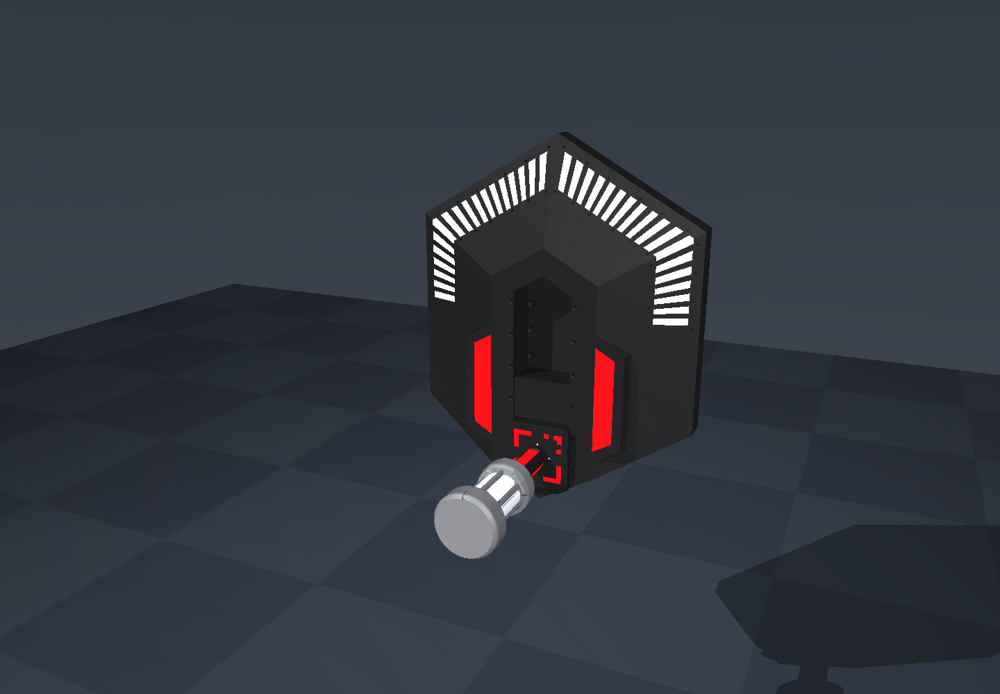

# RoboMaster 2026 科技核心与机械臂仿真

**联合键盘规划 Demo**：构建后运行 `./scripts/run_planning_demo.sh`。启动和 Backspace 均使用上游 URDF 的七关节零位；R 载入装配演示预设。WASDQE 控制机械臂末端，I/K、J/L、U/O 控制核心 XYZ，配合 Shift 控制 roll/pitch/yaw；1/2 切换 Baseline/RigidCache。**第一次回车用半透明机械臂虚影预览规划结果（包括失败），实体保持不动；预览成功后第二次回车才执行**。完整操作与范围见 [键盘规划 Demo](docs/planning_demo.md)。

独立 **RM26 version3 七关节机械臂**入口保留：真实 HKUST 网格、固定底座、位置/速度 mock 驱动，以及 WASD / 方向键控制末端平移。构建后运行 `./scripts/run_arm_software_viewer.sh`；完整操作、C++ API 和验证见 [机械臂使用说明](docs/rm26_arm.md)。

使用 **C++17 + MuJoCo 3.3.7** 模拟科技核心的定位、能量单元插入、升降、P 轴上翻、Q 轴角度装配和一至四级规则判定。支持键盘交互、CPU 无窗口演示、双核心四级协同、灯效、轨迹 CSV 和 PNG 截图。科技核心直接使用 HKUST 的 `exchange.blend` 详细网格，保留原始尺度、螺钉、倒角、六个 MARK 部件和 36 根角度灯条。



尺寸和流程依据仓库内的《RoboMaster 2026 机甲大师超级对抗赛比赛规则手册 V2.2.0（20260807）》。逐条尺寸、页码和建模假设见 [规则追溯](docs/rules.md)。`tech_core` 是**已对准能量单元的导向机构仿真**；`rm26_arm` 提供独立机械臂与逆运动学控制，两者尚未接入自由抓取、装配联动或视觉识别。

## 构建

自动依赖脚本面向 Linux x86_64。Ubuntu / Debian 可安装以下系统依赖：

```bash
sudo apt-get install build-essential cmake curl ca-certificates \
  libglfw3-dev libgl1-mesa-dev libpng-dev mesa-utils xvfb xauth
```

在仓库根目录执行：

```bash
./scripts/bootstrap_mujoco.sh
cmake -S . -B build -DCMAKE_BUILD_TYPE=Release
cmake --build build -j4
ctest --test-dir build --output-on-failure
```

脚本将官方 MuJoCo 3.3.7 包安装到 `.deps/mujoco-3.3.7`，校验下载包 SHA-256：`1895a2f71e86d9a6026703ebdc1fae32af07792805ac56f9a73abceca30dbe1c`，并在结束时清理下载临时目录。已有 MuJoCo 安装可用 `-DMUJOCO_ROOT=/absolute/path/to/mujoco` 指定。正常构建和运行不依赖 Python；`models/tech_core.xml` 已入库，仅重新生成模型时才需要 `python3 scripts/generate_model.py`。

纯 CPU、无图形依赖的构建方式：

```bash
cmake -S . -B build-headless -DCMAKE_BUILD_TYPE=Release -DTECH_CORE_VIEWER=OFF
cmake --build build-headless -j4
ctest --test-dir build-headless --output-on-failure
./build-headless/tech_core --headless --demo --level 3 --duration 15
```

关闭 `TECH_CORE_VIEWER` 后不能打开窗口或截图。CTest 包含原始网格保真、MARK 图案、规则、物理、四个等级、Q 正负极限、倾斜姿态演示和非法参数检查。当前验证记录见 [验证报告](docs/validation.md)。

## 交互与演示

有桌面环境时直接启动：

```bash
./build/tech_core
```

默认三级、手动操作。物理计算使用 CPU，但直接启动的 OpenGL 可能选择系统 GPU。在共享服务器上使用软件渲染脚本：

```bash
./scripts/run_software_viewer.sh --demo --level 3
```

该脚本明确使用 Mesa/llvmpipe，设置 `CUDA_VISIBLE_DEVICES=""`、Mesa GLX、软件渲染和 4 个渲染线程；没有 `DISPLAY` 时自动通过 Xvfb 创建显示上下文。启动输出会显示实际 OpenGL renderer。无桌面的运行建议加 `--duration`，到时自动退出；Xvfb 和授权临时文件由 `xvfb-run` 清理。

| 操作 | 按键 |
| --- | --- |
| 选择核心（四级） | Tab |
| 插入 / 取出 | 按住 I / K |
| 升起 / 降低 | 按住 U / J |
| P 轴上翻 / 返回 | 按住 O / L |
| Q 轴负转 / 正转 | 按住 A / D |
| 确认当前核心装配 | Enter |
| 自动演示开关 | G；**开启时重置场景并从头演示** |
| 释放 / 夹持虚拟夹具 | X |
| 装配区交互卡存在开关 | C |
| 暂停 / 重置 / 退出 | Space / R / Esc |
| 旋转、平移、缩放视角 | 鼠标左键、右键、滚轮；Shift 切换拖动方向 |

等待状态显示 `ready` 后再插入。一级只需插入并确认；二级还需升降；三级增加 P 上翻及 Q 到角；四级对两个核心分别完成这些动作。角度达标需停留 0.4 s；超过 2 s 后显示 `HOLD`。四级步骤 2、3、5、6 的双核心完成时间差不得超过 5 s，总装配时间从核心到位起不得超过 45 s。

## CPU 批量运行与输出

下面四个等级只运行 CPU 物理，不创建图形上下文：

```bash
for level in 1 2 3 4; do
  ./build/tech_core --headless --demo --level "$level" --duration 15 \
    --csv "artifacts/level-${level}.csv"
done
```

程序输出状态转换及最终 `SUCCESS` / `FAILED` / `INCOMPLETE`。无窗口模式成功返回 0，规则失败或时长结束仍未完成返回 2，参数或运行错误返回 1。`--duration` 单位为仿真秒；无窗口默认 15 s，可设为 `(0,3600]`。

CSV 以 50 Hz 记录每个活动核心的实际关节状态，包含时间、核心编号、阶段、插入/升降位移（m）、P/Q 角（rad）、目标角、安全保持、回零/保持力矩（N·m）和整个模型的接触数量。它记录 `mj_step` 后的观测，不是直接写入控制目标。

截图需要图形上下文，即使同时指定 `--headless`。无 GPU 截图示例：

```bash
./scripts/run_software_viewer.sh --headless --demo --level 4 --duration 15.1 \
  --csv artifacts/level-4.csv --screenshot artifacts/level-4.png
```

提供 `--view iso|front|rear|side|top|marker|unit` 检查视角，`--distance` 设置观察距离（m），`--no-overlay` 隐藏界面文字。检查 MARK 时可加 `--hide-unit`，只隐藏能量单元外观，物理状态不变：

```bash
./scripts/run_software_viewer.sh --headless --duration 0.01 \
  --view marker --hide-unit --no-overlay --screenshot artifacts/marker.png
```

这个检查命令尚未完成装配，返回 2 / `INCOMPLETE` 是预期结果。能量单元在正常运行中保持不透明。

可配置 E 点位姿、两核心目标角和第二核心姿态：

```bash
./build/tech_core --headless --demo --level 3 --duration 15 \
  --pose -0.09,0.2,0.6,10,80,5
```

四级和可重复采样示例（选项与值以空格分隔）：

```bash
./build/tech_core --headless --demo --level 4 --duration 15 \
  --pose -0.09,0.2,0.6,0,90,0 --target 35 --target2 -40 \
  --secondary-orientation 30,90,0
./build/tech_core --headless --demo --level 3 --seed 42 --duration 15
./build/tech_core --help
```

`--pose` 的六个值为 `x,y,z,θ,φ,α`，前三项 m、后三项度；默认 `(-0.09,0.2,0.6,0,90,0)`。四级第二核心与第一核心的 E 点 x、z 相同，y 减少 0.4 m；默认第二核心角度 `(30,90,0)`，可通过 `--secondary-orientation` 覆盖。默认 Q 目标为 `35°` 与 `-40°`。`--seed` 可重复生成平移位置和 Q 目标，不随机整个姿态空间。

输出目录自动创建，同名 CSV/截图会被覆盖。`build*`、`.deps`、`artifacts` 和 MuJoCo 日志不纳入 Git；批次任务应使用有限时长并在确认不需保留后清理相应输出。

## C++ 接口与数据流

项目包含两个可调用组件：`tech_core_rules` 是不依赖 MuJoCo 的规则状态机；`tech_core_sim` 包含模型加载、驱动、MuJoCo 步进、实际观测与规则更新。主程序和查看器是它们的调用方。

```text
SimulationConfig → MJCF + 核心位姿
Command → 虚拟夹具力控制 + 被动力矩 → mj_step
        → Observation → AssemblyRules → 灯效 / CSV / 交互显示
```

在链接 `tech_core_sim` 的 CMake 目标中可以直接运行：

```cpp
#include "tech_core/simulation.hpp"

int main() {
    tech_core::SimulationConfig config;
    config.level = 4;
    config.target_degrees = {35.0, -40.0};
    tech_core::Simulation sim(config);
    while (sim.time() < 15.0 && !sim.rules().failed()) {
        sim.drive_demo();  // 可替换为外部控制器调用 set_command(core, command)
        sim.step();       // dt = 0.001 s；关节观测、判定、灯效在此更新
        const auto measured = sim.observation(0);
        (void)measured;
    }
    return sim.rules().successful() ? 0 : 1;
}
```

`target_link_libraries(your_target PRIVATE tech_core_sim)` 会传播头文件、MuJoCo 依赖和默认模型路径。`Command{insertion,lift,flip,twist}` 使用 m、m、rad、rad；`set_command` 限制到机构行程范围。外部控制器在完成动作后调用 `confirm(core)`。`model()` / `data()` 可用于观测 MuJoCo 状态；规则组件也可直接接收外部 `Observation`。比赛难度解锁可调用 `AssemblyRules::difficulty_available`，命令行训练模式直接选级。

| 文件 | 职责 |
| --- | --- |
| `models/tech_core.xml` | 可直接加载的双核心 MJCF 模型 |
| `models/meshes/` | HKUST 原尺度核心及官方能量单元网格、校验清单 |
| `reference/hkust/` | 原始 Blender 模型、MIT 许可与来源记录 |
| `scripts/cad/` | 离线导出、CAD 核对和能量单元孔接口修订 |
| `include/tech_core/` | 规则与仿真公开 C++ 接口 |
| `src/simulation.cpp` | 驱动、物理步进、位姿转换与灯效 |
| `src/rules.cpp` | 装配顺序、到位、停留、同步、超时和失败判定 |
| `src/main.cpp`、`src/viewer.cpp` | CLI、CSV、交互窗口与截图 |
| `tests/` | 规则边界与物理检查 |
| `scripts/generate_model.py` | 可选模型生成器，仅使用 Python 标准库 |
| `docs/rules.md` | 规则页码、官方参数与假设区分 |

## 仿真范围与假设

独立的三级机械臂规划扩展见 [基线来源](docs/planning_reference.md)、[抓取与碰撞场景](docs/planning_scene_audit.md)。它使用原七关节臂、固定夹持的能量单元和单核心联合场景；下面原 `tech_core` / `rm26_arm` 的物理演示范围保持各自定义。

- 核心视觉由用户指定的 HKUST 原模型按比例 1 导入：59 个对象、60 个网格、34,792 个三角面。外壳宽 448.601 mm、高 566 mm；MARK 外轮廓 80×80 mm，保持手册规定的右上角不对称图案。来源、离线复现和官方 CAD 对比见 [几何来源](docs/fidelity_sources.md) 与 [尺寸审计](docs/fidelity_geometry_audit.md)。
- 能量单元外形来自官方 STEP，质量取规则名义值 0.4 kg、长 150 mm。官方附件的浅孔与规则有出入，因此单独修订为 φ40 mm、深 100 mm 的可见孔接口，保持所有外表面不变；细节见 [能量单元 CAD](docs/energy_cad.md)。碰撞用独立的不可见空心代理，未把凹形外观直接凸包化。
- 原始 Blender 文件和材质参数保留，但 MuJoCo 材质不等同于 Blender 的程序化纹理、混合 BSDF 和 Cycles 光照；当前重点是几何、标识和装配行为，未标定实物反射率。
- `tech_core` 的单元受四个导向自由度约束，夹具对这些自由度施力。该场景没有自由体抓取、机械臂联动、夹爪接触或资源区取物；独立 `rm26_arm` 场景的 IK 不参与核心装配，接触成功不代表任意初始误差下能完成插接。
- 内部关节链仍是规则动作的近似：P 固定在初始 E 的 `(-169,0,208) mm`，升降 100 mm 后柱轴至 P 高度差为 108 mm。Q 沿面板法向，P 沿横向，柱及标识随装配动作运动。该串联链和滑块归属不代表已恢复真实闭链机构；Q 转动使翻起后的单元侧倾。
- 核心使用运动学定位，1 s 到位；没有支撑机械臂动力学。倾斜姿态下的插入/升降方向采用核心局部坐标。位姿转换使用 `Rz(θ) Ry(φ−90°) Rx(α)`。
- 规则“5° 精准度”在这里解释为 Q 绝对误差 ≤5°；平移容差 3 mm、P 容差 2°、存在阈值 5 mm 是传感判定假设。三级和四级在插入、升降和 P 上翻完成前要求 Q 保持零位 ±2°，用于落实先 P 后 Q 的步骤顺序；零度 Q 目标仍可直接驻留达标。Q 连续达标提示取官方 0.3–0.5 s 区间内的 0.4 s。
- 升降/插入方向使用 10 N 摩擦近似；Q 回零力矩限制为 0.3 N·m，保持伺服限制为 0.5 N·m。释放后的安全保持另外采用理想重力支撑，表达官方允许脱离的效果，不是已辨识的真实锁止机构。
- 外壳与滑块仅用于显示，不参与碰撞；接触筛选包含每个核心自身的能量单元/装配柱及地面。双核心外壳与跨核心物体不做碰撞约束，因此四级演示不构成双机械臂避碰验证。
- 位姿检查先约束表 5-10，再使用模型包围盒检查**到位、装配前**的核心几何不超过底座正面 `X=0`（不含待操作单元）。这是保守的末端姿态筛选，没有扫描定位途中或后续装配运动的扫掠体，不是路径避碰规划器。
- 命令行是直接选级的训练环境，不是完整裁判系统。比赛时间解锁、双方抢占仲裁、经济收益、自动实体回收和已用单元库存未接入；成功后保留当前场景以供检查。参考 [规则追溯](docs/rules.md) 中比赛级规则与当前组件的边界。

## 三级规划与耗时基准

已完成 HKUST 任务雅可比基线与 **8 种额外方案、621 次请求**的冻结评测，详见 [完整结果与复现](docs/planning_results.md)。成功规划的基线中位耗时 **0.651 s**，推荐 `rigid_cache` 为 **0.309 s**（P95 **0.378 s**，最大 **0.380 s**），配对中位减时 **53.22%**。计时包含在线碰撞检查，不含执行。**正例完成率为 10/20（50%）**，所有方法成功集合相同；这证明已完成轨迹满足 3 s 目标，不代表整个三级工作空间均能规划。

规划扩展需要 Eigen3（如 Ubuntu 的 `libeigen3-dev`）。规划计算全程 CPU，不创建渲染上下文，也不模拟抓取动力学。

完整轨迹的 CPU 视频回放及按用户要求将实际间距缩短 100 mm 的演示见 [视频说明](docs/planning_video.md)。

40 个倾斜核心位姿、基座下降 100 mm、4 倍运动速度和 Q：0° → +90° → −90° 的[在线重跑与视频](docs/pose40_online.md)已完成：固定实际关节起点，在线重试和密碰撞验证共用 3 s 时限，20/40 成功，成功耗时中位数 1.230 s、最大 2.809 s；其余请求保留失败记录。

```bash
cmake -S . -B build-planning -DCMAKE_BUILD_TYPE=Release -DTECH_CORE_VIEWER=OFF
cmake --build build-planning -j4
CUDA_VISIBLE_DEVICES='' ctest --test-dir build-planning --output-on-failure
./build-planning/rm26_plan --list
python scripts/run_planning_benchmark.py --executable build-planning/rm26_plan \
  --output artifacts/level3_planning/my_run --method all --repeat 3 --dense-check
OPENBLAS_NUM_THREADS=1 python scripts/audit_planning_trajectories.py artifacts/level3_planning/my_run
```

每次使用新的输出目录。`runs.csv` 保留每个方法、场景、重复的成功、失败原因和实际规划耗时；`trajectories/` 保存关节、阶段、目标与时间戳。在线 IK、采样、时间化及碰撞/轨迹验证计入规划；模型加载、离线 atlas 构建和额外密采样复查单独记录。`summary.json` 区分开发、确认与拒绝测试，配对加速仅比较双方成功的相同请求。独立 Python 审计从原 URDF 重新 FK，不代表第二套网格碰撞算法。

链接 `rm26_planning` 可直接在内存中调用：

```cpp
#include "tech_core/planning.hpp"
using namespace tech_core::planning;
PlanningScene scene;
Scenario request = scenario_suite().front(); // 可替换核心位姿、当前七关节及安装外参
PlanOptions options;
options.method = Method::RigidCache;
PlanResult result = plan(scene, request, options);
if (result.success) { /* result.knots 是完整已验证轨迹 */ }
// 失败时 knots 可能仅为前缀，或是一条被验证器拒绝的候选；不得执行。
```

每个工作线程使用独立 `PlanningScene`；调用者不得修改其碰撞几何来绕过验证。轴自由的 IK 只约束开口中心与单元长轴，携带物实际姿态始终由臂 FK 和固定夹持变换确定。离散碰撞采样不是连续碰撞证明，安装/抓持外参尚须实物标定。

Q 末段已支持在在线预算内尽量转动：[40 位姿 Q 范围报告与视频](docs/pose40_q_range.md)。同一组位姿得到 20 个完整往返、15 个部分转动、5 个未执行；可执行方案的在线规划耗时为 0.879–2.941 s，保留全部原有严格往返成功项，密碰撞复查通过。
