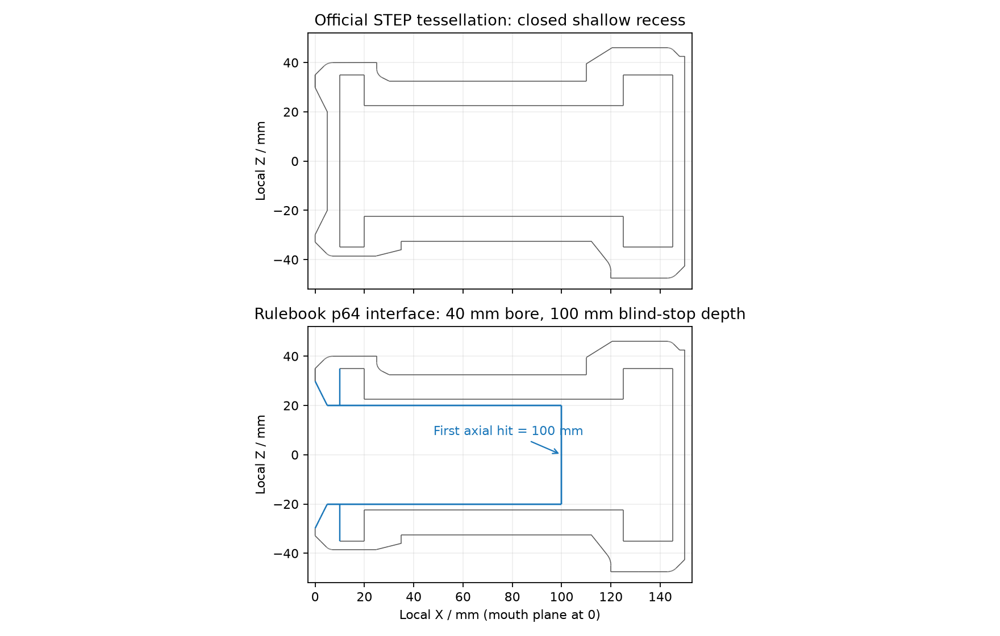

# 能量单元：官方 STEP 导入与几何核验

来源是 RoboMaster 官方论坛[场地模型发布帖 814728](https://bbs.robomaster.com/article/814728)附件[能量单元.stp](https://hz-rm-bbs-web-prod.oss-cn-hangzhou.aliyuncs.com/21cbbecaaceb47729bc477cd12f8de5b1761107116144/能量单元.stp)。附件为 842,155 字节，SHA256 为 `35d105a221f4527e5c5e84ac607c94c797ec2e19c734974de4c5485c2c2d5ee7`。文件内产品编号为 `111000111`，Creo Parametric 导出时间为 `2025-10-21T19:58:35`，单位为毫米。

这不是根据图片重新描画的外壳。`scripts/cad/import_energy.py` 通过 OpenCascade STEPCAF 读取全部 BRep 面及颜色，按颜色保留曲面、倒角、槽口、筋条和内部结构。默认弦差为 0.05 mm、角度为 8°；OBJ 存储米制顶点和逐 CAD 曲面的解析法线，保留锐边。

`models/meshes/energy_unit/manifest.json` 记录来源、校验和、坐标变换、全部 291 个源面、面类型、解析圆柱半径、包围盒、三角面数量、颜色和输出校验和。

| 网格 | 源面数 | 用途与颜色 |
| --- | ---: | --- |
| `energy_gray_body.obj` | 210 | 官方实体的灰色表面，原 sRGB 为 `(0.42, 0.42, 0.42)` |
| `energy_white_panels.obj` | 48 | 官方实体的白色表面，原 sRGB 为 `(1, 1, 1)` |
| `energy_auxiliary_surfaces.obj` | 33 | STEP 中额外的 SURFACE / COPY_GEOM 曲面，含重复面，不作为默认实体外观显示，但完整保留 |

源 CAD 为一个有效实体，含闭合 FORWARD 外壳和闭合 REVERSED 内腔壳；另有非实体曲面 compound。全部源面都有非空三角化。没有把辅助曲面错误地当作额外零件叠加到实体上。

## 坐标和外形

原 CAD 沿 `+Y` 从小端走向大端。对照规则手册 V2.2.0 第 64 页图 4-39，小端为装配孔入口侧，外圆标注 φ80；大端外圆标注 φ95，端面 φ85。导出坐标定义为：

```text
local_m = [CAD_Y, -CAD_X, CAD_Z] / 1000
```

原点是小端外端面中心，局部 `+X` 指向大端盖，整体轴向范围 `[0, 0.150] m`。这是右手旋转加毫米至米的单位变换，不含缩放修形。外形曲面包含 φ80 小端、φ60 面板、φ65 筋条、φ95 大端和 φ85 端面，与规则相应标注一致。

对原 CAD 沿 `Y` 做精确 BRep 截面并采样截面曲线，可得以下最大外半径；采样及 CAD 数值容差可能产生约 `0.00003 mm` 的末位偏差：

| 原 CAD Y / mm | 最大外半径 / mm |
| ---: | ---: |
| 0 | 35.000000 |
| 5 | 39.550919 |
| 10 | 40.000016 |
| 25 | 40.000016 |
| 40 / 75 / 100 | 32.500000 |
| 110 | 41.250003 |
| 125 | 47.500029 |
| 145 | 47.050912 |
| 150 | 42.500000 |

## 官方 CAD 与最新规则的孔深差异

**该附件自身未提供规则图中的 100 mm 开放装配孔，不能把原样导入宣称为完整符合 V2.2.0 的能量单元。**

规则第 64 页图 4-39 显示 φ40 装配孔和入口至铁片的 `100±1 mm` 深度。附件的几何则为：入口处是锥形凹坑，源面 189 在 `CAD Y=5 mm` 处封闭；实体分类器证实轴线上 `Y=4.9` 为 OUT、`Y=5.1` 为 IN、`Y=9.9` 为 IN、`Y=10.1` 为 OUT。随后是封闭内腔，末端 `Y=145..150 mm` 为端盖实体。该差异存在于有效 BRep 实体，不是重复辅助曲面或导出朝向造成的假象。

`energy_unit/` 中的原始导入保留官方附件，未删面、钻孔、改色或虚构材料。规则约束的装配孔修订另存在 `energy_unit_rule/` 中，不能仅将碰撞设为关闭来冒充真实孔。

## 按第 64 页修订的装配孔接口

`scripts/cad/correct_energy_bore.py` 生成独立的 `models/meshes/energy_unit_rule/` 版本。原始目录保持不变，修订 manifest 记录原始 manifest 的 SHA256 和每项改动。

修订仅涉及四个孔内表面：移除源面 189 的浅凹坑封闭圆盘；源面 187、188 的原有圆锥只裁掉半径小于 20 mm 的末端；源面 254 的 `Y=10 mm` 内腔圆盘只去掉半径小于 20 mm 的中心。原口锥达到 R20 的位置为 `X=4.939339833 mm`，从这里接 φ40 内壁至 `X=100 mm`，并在 `X=100 mm` 添加盲孔终端铁片可视平面。

内壁和终端片是由规则定义的**零厚度可视接口**。内部未公开的制造壁厚、铁片厚度、分件方式和新增质量均没有推测。碰撞代理应与这套明确的孔径/孔深接口匹配，不能直接使用其凹形网格的凸包。

其余全部官方实体表面的 OBJ 顶点、法线及面记录保持原字节：原灰色对象保留 15,158 个原三角面，白色面板文件完整按字节复制。新接口采用原 CAD 灰色。所有被引用顶点形成的外形包围盒逐浮点值完全相同。

中心及径向偏移 10 mm、19.9 mm 的七条沿轴射线，首次与最终可见网格相交的位置均为 `100 mm`；φ40 内壁采用 180 边三角网格，最大径向弦差为 `0.00305 mm`。修订部分法线、绕序以及这些射线都经过测试。

下图是原始及修订后的**实际三角网格截面**，蓝色显示修改的孔内接口，外部轮廓重合：



## 复现和验证

离线工具依赖 `cadquery-ocp==7.8.1.1`、NumPy；MuJoCo C++ 运行不依赖这些 Python 库。

```bash
build/fidelity-research/cad-env/bin/python scripts/cad/import_energy.py \
  --source build/fidelity-research/official/energy_unit.stp \
  --output models/meshes/energy_unit

build/fidelity-research/cad-env/bin/python scripts/cad/correct_energy_bore.py \
  --source build/fidelity-research/official/energy_unit.stp \
  --section-image models/meshes/energy_unit_rule/cross_section.png

build/fidelity-research/cad-env/bin/python scripts/cad/test_energy_import.py
```

6 项离线测试通过，覆盖全部源面分区、BRep 有效性/内外壳方向、单位及坐标方向、官方颜色、全部原始/修订 OBJ 法线与三角面绕序一致性、原始浅凹坑、规则孔径/孔深射线，以及外形与原网格记录保真。测试临时目录自动清理。源 STEP 缺失时测试明确跳过；源文件校验和不符时导入立即失败。可选截面图使用 CPU Matplotlib。
