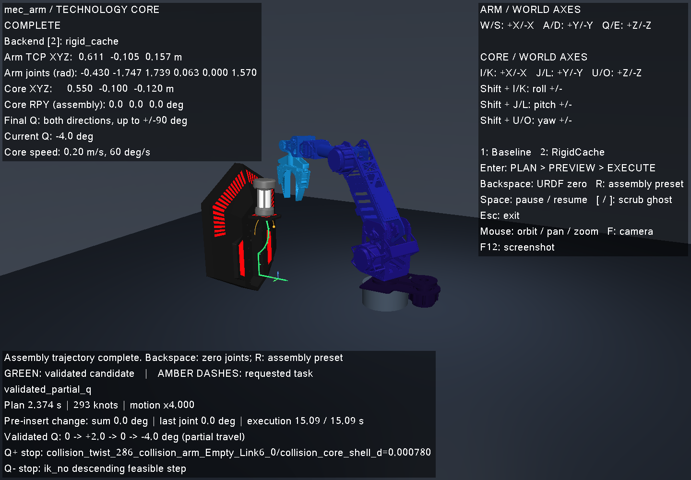

# MecArm 直立工位验证（2026-10-14）

本次直接修改 `models/mec_arm/robot.json` 并重新生成模型。核心由大角度倾斜改为世界坐标 `[0.55,-0.10,-0.12] m`、世界 RPY `[0,0,180]°`；地面 Z 为 −0.25 m。单元挂载变换和六轴装配预设同步调整。源 URDF、网格、关节限位、规划算法和碰撞阈值没有改动。

- `ctest.log`：`multi_arm_contract`、`mec_arm_assembly` 两项通过；包括 Baseline / RigidCache 完整装配、加密且关闭缓存的轨迹复验、阻挡与不可达负例。
- `runs.csv` / `scenarios.csv` / `robot.csv` / `trajectories.tar.xz`：新名义预设的 RigidCache 轨迹及无缓存加密复验。`audit.json` 是独立 Python 源 URDF 审计，1 条轨迹有效、0 个错误。
- `fk.json`：68 个姿态的全部 11 个源连杆、TCP 与雅可比对照通过。
- `keyboard.json` / `.jsonl`：真实 GLFW 窗口在 Xvfb 中完成 R 预设、规划、保持实体不动的预览、再次 Enter 执行、COMPLETE、归零。
- `live.json`：桌面 WSLg 交互窗口经定向 X11 按键事件完成同一流程，最终保持 COMPLETE；插入 100 mm、抬升 100 mm、P 翻转 90°，执行约 15.09 s。
- `summary.json` 保存本次配置校验值；`reproducibility.json` 确认导入器离线重新生成三个输出逐字节一致。

直立工位的 best-effort Q 实测为 **+2° → −4°**。正向下一段触及原有碰撞间距，负向下一段逆解无法继续；没有达到完整 ±90°。旧倾斜工位的 +22° → −65° 结果属于旧配置，不能套用到这次修订。虚拟转接没有实体碰撞几何或硬件标定；本次仍为实验室运动学仿真。

当前预设与完成画面：




复现：

```bash
python3 scripts/import_robot.py
ctest --test-dir build --output-on-failure -R 'multi_arm_contract|mec_arm_assembly'
./build/arm_plan --robot mec_arm --case dev_nominal --method rigid_cache \
  --timeout 10 --dense-check --output artifacts/mec-upright-check
.venv/bin/python scripts/audit_planning_trajectories.py artifacts/mec-upright-check \
  --robot mec_arm --expected-runs 1
./scripts/run_planning_demo.sh --robot mec_arm
```

窗口按 R → Enter → 成功预览后 Enter。审计环境需要 NumPy。
