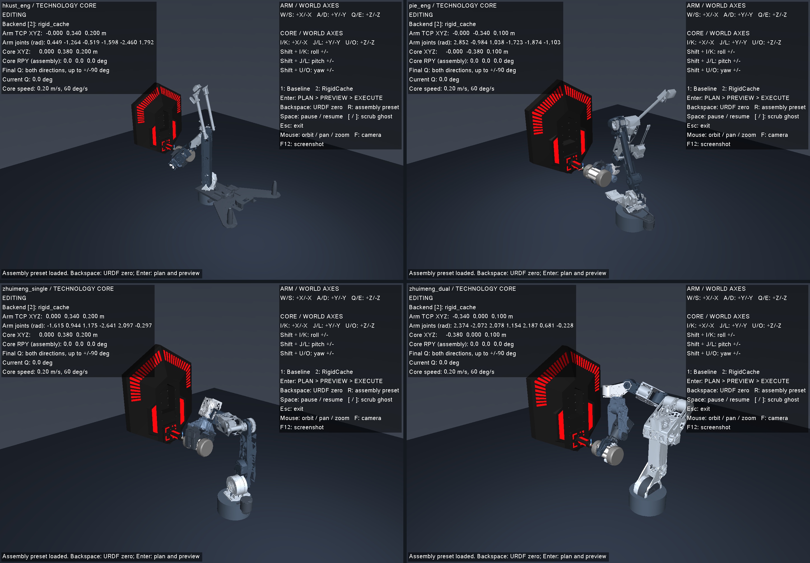

# 四套 CAD 导出机械臂

`hkust_eng`、`pie_eng`、`zhuimeng_single`、`zhuimeng_dual` 已接入同一套控制、FK/IK、装配规划和 MuJoCo 交互窗口。`zhuimeng_dual` 使用左臂七轴，躯干固定在源零位，右臂不进入运行场景。

| 模型 ID | 来源 | 控制轴数 |
| --- | --- | ---: |
| `hkust_eng` | 香港科技大学 ENTERPRIZE，ENG Open | 6 |
| `pie_eng` | 首都师范大学 PIE，RM2026 工程机器人 | 6 |
| `zhuimeng_single` | 北京理工大学 DreamChaser，国赛单臂 | 6 |
| `zhuimeng_dual` | 北京理工大学 DreamChaser，国赛双臂的左臂 | 7 |



## 使用

```bash
./scripts/run_planning_demo.sh --robot hkust_eng
./scripts/run_planning_demo.sh --robot pie_eng
./scripts/run_planning_demo.sh --robot zhuimeng_single
./scripts/run_planning_demo.sh --robot zhuimeng_dual
```

四套新模型默认启动于各自的装配预设：科技核心直立、接口朝向机械臂，能量单元开口与核心柱同轴，距预插入位置的基准接口 40 mm。**Enter** 规划并显示虚影，预览成功后再次 **Enter** 执行；**R** 恢复本模型预设，**Backspace** 回到源 CAD 的主动关节零位。末段 Q 沿用现有 demo 的双向尝试，仅执行通过验证的角度范围。完整键盘操作见[交互说明](planning_demo.md)。

下表为机器人基座世界坐标系中的初始核心接口位置，单位为米。地面位于 Z = −0.25 m；核心局部 Z 均与世界 Z 平行。

| 模型 | 核心接口 XYZ | 接口朝向 | 单元开口 XYZ |
| --- | --- | --- | --- |
| HKUST ENG | (0, 0.38, 0.20) | −Y | (0, 0.34, 0.20) |
| PIE ENG | (0, −0.38, 0.10) | +Y | (0, −0.34, 0.10) |
| 追梦单臂 | (0, 0.38, 0.20) | −Y | (0, 0.34, 0.20) |
| 追梦双臂左臂 | (−0.38, 0, 0.10) | +X | (−0.34, 0, 0.10) |

这些是各自重新验证的实验室装配预设，不直接套用原 RM26 的场地外参。

独立机械臂窗口也携带能量单元，启动于同一验证过的操作姿态，避免折叠零位附近方向受限。源 CAD 零位仍保留；联合窗口的 **Backspace** 可查看：

```bash
./scripts/run_arm_software_viewer.sh --robot pie_eng
./build/arm_control --list-robots
./build/arm_control --robot zhuimeng_dual --headless --demo --duration 1
./build/arm_kinematics_example hkust_eng
./build/arm_plan --robot pie_eng --case dev_nominal --method rigid_cache \
  --timeout 10 --dense-check --output artifacts/pie-plan
python3 scripts/audit_planning_trajectories.py artifacts/pie-plan \
  --robot pie_eng --expected-runs 1
```

## 来源与模型处理

在源目录的 `finished` 出现后复制了完整导出包。原始 URDF、47 个 STL、关节表、零件清单、作者条款与原验证截图保存在 [reference/exported_arms](../reference/exported_arms/README.md)，187 个源文件的字节校验见 [checksums.json](../reference/exported_arms/checksums.json)。原导出器提交为 `5296cd42557c14176487d39458fa6977bf12c4d9`。运行与离线重建均不依赖原来的 `/mnt/d` 路径。

每个 `models/<ID>` 包含 `robot.json`、派生的 `adapted.urdf`、显示网格、碰撞网格，以及控制用 `scene.xml` 和装配用 `planning.xml`。主动关节的轴、原点、零位和源显示范围保持不变。辅助夹爪变成固定关节，固定角度/位移与能量单元外参写入 `robot.json`；左右夹指的原 mimic 关系在固定姿态中保持。

能量单元采用夹指之间的侧向抓持。挂载点按实际指形、65 mm 中段及两端较粗的法兰/尾盖调整，能量单元开口仍是装配规划的 TCP。HKUST 的固定夹爪角约 0.691 rad，超过原导出查看器默认的 ±0.6 rad；该范围在源文档中明确不是机械限位，原 URDF 未修改。所有抓持都是刚性运动学装配假设，不模拟夹紧力或释放动作。

源包未提供质量、惯量或驱动参数，速度/力矩为零占位，关节范围也只是查看器范围。本项目用数值惯量和 0.6 rad/s 的仿真速度设置运行运动学控制，不能把这些设置作为实体机械臂参数。PIE 源包有 7 个空几何引用，详细清单及原使用条款均保留在对应源目录。

## 碰撞与验证

显示网格经过简化，原始 STL 完整保留。碰撞几何直接由原始三角面生成：连杆采用空间分区凸包，必要的末端按源零件拆分，夹指采用保持外轮廓凹口的凸棱柱分解。棱柱覆盖源投影及原轴向厚度，内部螺孔可以填实；报告记录未覆盖投影面积、各文件及生成版本。

除原有同刚体/相邻运动簇规则外，模型明确声明复合腕部的两轴轴承壳体关系；双臂左臂另声明躯干与第二肩轴的嵌套轴承关系。运行时只接受跨恰好两个相邻关节的祖先/后代声明。这些是机械连接处的自碰撞排除，手臂与载物、核心、地面及其他连杆的碰撞仍检查，不使用任意几何接触豁免。

`exported_arm_test` 覆盖每种模型的控制、五种 IK 方法、单臂/固定夹爪约束、载物、直立核心、起始相对位姿、Baseline/RigidCache/BoundedQP 装配、关闭缓存后的加密回放，以及障碍物和不可达目标拒绝。所有装配规划后端统一使用 1 µm / 1 µrad 的 IK 终止精度，并对中间位置误差超过 25 µm、轴向误差超过 0.1 mrad 或碰撞检查失败的关节插值段加点，再进行完整轨迹验证。该处理修复追梦单臂翻转时端点正确、插值侵入接触边界的问题；碰撞接受阈值保持不变。`verify_robot.py` 直接读取未改动的源 URDF，在 68 个操作起点/零位/边界/随机姿态对照所有保留连杆和末端，并通过差分检查雅可比。

本次构建、交互、轨迹与离线重建记录见[验证证据](evidence/exported_arms_20261014/README.md)。

```bash
ctest --test-dir build --output-on-failure
python3 scripts/verify_robot.py --config models/pie_eng/robot.json \
  --probe build/robot_probe
xvfb-run -a python3 scripts/test_robot_demo_keyboard.py \
  --robot pie_eng --expect-preset-start --output artifacts/pie-keyboard
```

无窗口构建沿用 `-DTECH_CORE_VIEWER=OFF`。实际窗口测试通过 X11 键盘事件验证预设、规划、虚影、执行完成及回零；无显示环境使用 Xvfb 和 Mesa 软件渲染。

## 离线重建

常规 C++ 构建直接使用已提交模型，无需 Python。重建几何需要 NumPy、SciPy、trimesh、fast-simplification、Shapely，确切版本见每个模型的 `geometry_report.json`。

```bash
python3 -m pip install -r scripts/requirements_exported_arms.txt
python3 scripts/import_exported_arms.py
# 仅更新固定抓持外参、场景元数据，保留已有网格：
python3 scripts/import_exported_arms.py --reuse-meshes
# 单独重建一个模型：
python3 scripts/import_exported_arms.py --robot zhuimeng_single
```

`--collision-only` 可保留显示网格，`--link` 可限定重建连杆。这些命令只写派生模型包，不改变原始导出文件。通用模型包接口见[多机械臂指南](multi_arm.md)。
