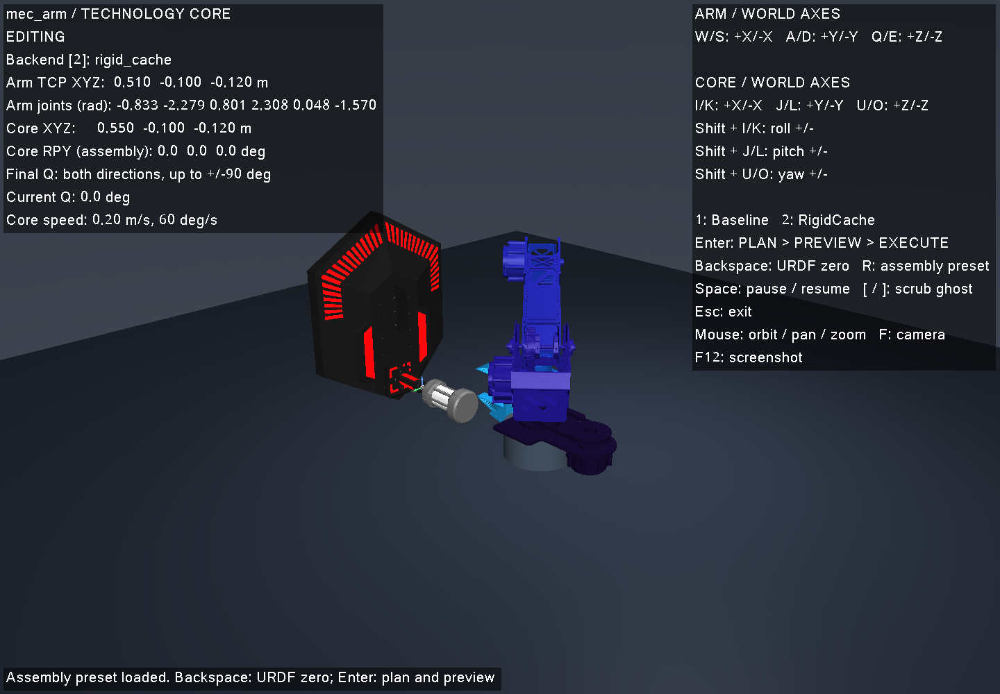

# MecArm 六轴机械臂

MecArm 已接入同一套关节/笛卡尔控制、独立 FK/IK、装配规划、碰撞检查、交互预览、轨迹导出和回放。选择 `--robot mec_arm`；架构和第三方接入流程见[多机械臂指南](multi_arm.md)。

```bash
./scripts/run_arm_software_viewer.sh --robot mec_arm
./scripts/run_planning_demo.sh --robot mec_arm
./build/arm_kinematics_example mec_arm
```

联合窗口按 **R → Enter → 预览成功后 Enter**，分别载入预设、规划和执行。末段 Q 尝试正反方向，保留通过验证的范围。程序启动于源 URDF 的关节零位，零位和装配预设是不同姿态。



## 源模型与坐标

来源为 [yagami-light7/MecArm_Kinematics/mec_arm_model](https://github.com/yagami-light7/MecArm_Kinematics/tree/5b00fbc32a32b79a89ff9520c4fe13f2eaf0a945/mec_arm_model)，固定提交：

```text
5b00fbc32a32b79a89ff9520c4fe13f2eaf0a945
```

上游模型包的全部 **15 个文件**已保存：7 个 STL 位于 `models/mec_arm/meshes`；URDF、CSV、ROS 包信息、配置、launch、CMakeLists 和导出日志位于 `reference/mec_arm`。每个文件的来源、长度与 SHA-256 见[来源清单](../reference/mec_arm/manifest.json)。`package.xml` 声明 BSD，但该提交没有模型包/仓库根独立许可证正文；不推定具体 BSD 变体。模型包之外的嵌入式代码不是仿真运行依赖。

主动关节顺序为 `Joint1` 至 `Joint6`，全部使用源 URDF 限位：

| 关节 | 下限 rad | 上限 rad |
| --- | ---: | ---: |
| Joint1 | -3.10 | 3.10 |
| Joint2 | -2.60 | 0 |
| Joint3 | 0 | 4.00 |
| Joint4 | -3.10 | 3.10 |
| Joint5 | 0 | 3.10 |
| Joint6 | -1.57 | 1.57 |

保留 `Joint4_zero_offset`、`Joint5_zero_offset`、`Joint6_zero_offset` 的固定变换；TCP 是源 `TCP_link`，含 `TCP_fixed_joint` 的 0.20 m 偏置与 -0.8724 rad 偏航。导入后共 11 个源连杆。独立控制 `home` 为 `[0,-1.3,2,0,1.2,0]` rad。源速度声明为 2 rad/s，当前运动学驱动采用配置中更低的 1 rad/s；动力学惯量是数值占位。

## 装配预设与适用范围

MecArm 源包没有科技核心夹具或抓持外参。本项目配置了**虚拟刚性侧向转接**，用于验证六轴模型贯穿整个装配软件流程：单元开口相对源 TCP 平移 `[-0.14,0,0.06] m`，方向四元数 `[√0.5,0,√0.5,0]`，即绕局部 Y 轴旋转 +90°，单元纵向 +X 对应源 TCP −Z；源 TCP 本身不变。转接件没有实体碰撞几何或硬件标定，源网格和单元、核心的碰撞仍完整检查。此预设不构成真实夹爪或转接件设计验证。

[robot.json](../models/mec_arm/robot.json) 保存固定的装配起点、核心位姿和装配坐标系外参。核心现在**直立并面向机械臂**：开口世界坐标 `[0.55,-0.10,-0.12] m`，世界 RPY 为 `[0,0,180]°`。地面为世界 Z = −0.25 m，开口高于地面 0.13 m；世界零点位于机械臂底座，因此负 Z 不表示埋入地面。界面显示装配坐标系中的 RPY `[0,0,0]°`，装配系本身绕世界 Z 轴旋转 180°。按 R 载入的机械臂起点位于开口外侧 40 mm。

这仍是实验室工位；`enforce_core_pose_limits=false` 明确关闭官方位姿表/前平面门槛。关节边界、机器人自碰撞、核心/载物碰撞和完整插入、升降、P 翻转、Q 对准、驻留规则均保留。不能将这个可行预设解释成满足 RoboMaster 官方所有工位要求。

`dev_nominal` 的固定 Q 目标为 0°，仍完成 100 mm 插入、100 mm 升降、90° P 翻转、对准与驻留。新的直立工位中，交互 best-effort 模式实测通过的 Q 范围为 **+2° 再反转至 −4°**：正向在下一段触及原有碰撞间距，负向在下一段无法继续逆解，没有达到完整 ±90°。不可达位置和阻挡工装仍被拒绝。每次失败都会保留原因及已检查的候选前缀，执行入口只接受完整验收成功的结果。

## 验证

[直立工位验证记录](evidence/mec_arm_upright_20261014/README.md)保存本次修改的配置校验值、规划 CSV、独立审计和窗口事件；[最初接入记录](evidence/multi_arm_20261014/README.md)保留旧倾斜工位的历史结果。主要检查包括：

- 68 组源 URDF 姿态与 MuJoCo 对照，覆盖全部连杆及 TCP；最大位置误差小于 `8×10⁻¹⁶ m`，姿态矩阵误差小于 `2×10⁻¹⁵`，TCP 雅可比差分误差小于 `4×10⁻¹⁰`。
- Baseline 与 RigidCache 的完整装配、两倍密度且关闭缓存的 C++ 复验；Python 审计独立从源 URDF 重建姿态与装配机构运动。
- 真实 X11 窗口完成载入预设、只预览不移动、再次确认后执行、完成、归零；全程六个关节。
- 外部模型包的直线/旋转混合关节、重排命令顺序、错误维度和错误元数据拒绝。

可复现文件为[导入报告](../models/mec_arm/import_report.json)、[FK 验证](../models/mec_arm/verification.json)与[源文件清单](../reference/mec_arm/manifest.json)。重新生成：

```bash
python3 scripts/import_robot.py
python3 scripts/verify_robot.py --probe build/robot_probe
python3 scripts/audit_planning_trajectories.py --robot mec_arm --self-test
```

无头依赖、窗口、审计与源模型下载说明见[接入指南](multi_arm.md)。
