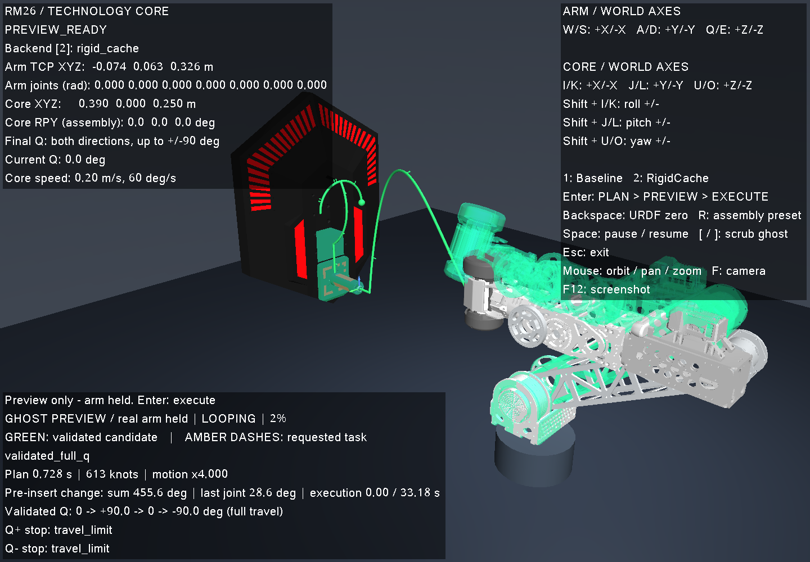

# 预插入关节变化与大范围规划质量

2026-10-11，算法提交 `8859a1c`。本次重点是从实际起点移动到预插入点时少转关节，尤其是最后一个轴；同时提高两个 Demo 后端完成完整装配前缀的成功率。

后续 Q 碰撞边界局部换解及其单独复验见 [Q 换解修正](q_collision_recovery.md)。本文数值保留为 `8859a1c` 的历史结果。2026-10-13 对当前代码和修正前版本分别重跑的结果见 [本机复现记录](reproduction_20261013.md)。

当前 `fd6e983` 的两后端各 100 次整体成功率见 [100 次复测](planner_success100.md)：两者均为 31/100，所有失败均计入分母。

## 第一段的变化

默认七关节零位、名义核心位姿，预插入点仍为 E 外侧 40 mm：

| 指标 | 原 Baseline | 原 RigidCache | 新 Baseline | 新 RigidCache |
| --- | ---: | ---: | ---: | ---: |
| 预插入末轴角度变化 | 118.46° | 118.41° | 28.65° | 28.65° |
| 预插入七关节绝对变化之和 | 574.20° | 574.64° | 455.55° | 455.55° |
| 接近及 40 mm 对准的末轴累计转动 | 128.86° | 128.86° | 32.62° | 32.62° |
| 接近及对准的七关节累计转动 | 10.597 rad | 10.606 rad | 8.455 rad | 8.455 rad |

末轴预插入变化减少约 76%，七关节变化之和减少约 21%。这里的“和”是七个轴分别取绝对值后相加，不是一个关节转了 455°。两种后端在这个场景仍完成插入、升降、P 翻转及完整 Q `0 → +90 → 0 → −90°`。装配预设起步也保留原来较短的接近路径。



候选目标使用 `sum(abs(delta_q)) + 3*abs(delta_q6)` 排序，即额外惩罚末轴变化。先尝试末轴保持起始角度，再尝试 ±0.5、±1、±1.5 rad 和自由末轴；同时保留正常 IK 解。每个目标都使用实时 FK/IK 和碰撞检查，并检查后续插入、升降和 P 连续逆解，不能仅靠第一步角度小就接受。最终仍经过有碰撞检查的 RRT-Connect/捷径优化及整条路径的密集验收。

搜索使用实际起点、一个通用装配预设、关节范围中心和固定随机扰动；不读取逐位姿预计算解，不跨请求热启动。前 15% 预算用于正常 IK 候选，全部姿态搜索上限为 25%；后续连接、失败重试、Q 扩展及最终验收共用剩余预算。候选排序是启发式：不保证任意场景都比旧路径短，也不保证全局最优或最大 Q 范围。

两个后端共享上述策略、失败时的有界 QP 恢复、刚体配对缓存和精确状态缓存。Baseline 的轨迹 IK 使用六行任务雅可比；RigidCache 使用五维任务和预测步。优化模式的端点 IK 容差为 1 µm / 1 µrad；装配段根据中间 FK 误差与碰撞检查细化，处理“端点合格、关节弦段越过接触边界”的问题。碰撞间距和接触阈值没有放宽。

此外，修复了焊接刚体配对的网格距离随世界旋转发生数值变化的问题：这类配对始终使用同一参考姿态的相对几何，无论缓存是否打开。只有相对变换恒定的配对采用这个处理。新回归覆盖原先出现 0.444 mm 伪穿透的 33 个状态，缓存与无缓存结果一致。

## 固定评测范围和分母

输入在优化前固定，见 [cases.csv](evidence/planner_quality/cases.csv) 和 [protocol.json](evidence/planner_quality/protocol.json)。核心相对名义位置 XYZ 各 ±20 cm，roll/pitch/yaw 各 ±90°，六维拉丁超立方采样：32 个开发位姿、独立种子生成的 100 个扩展评测位姿，每个位姿分别从七关节零位和装配预设起步。默认 Demo 安装不变，核心位姿/前平面限制关闭，5 s 在线预算，速度倍率 4。另完整保留旧 40 位姿及其安装、起点，加入 4 个障碍/远距离负例。每种后端共 308 个请求。

扩展评测保留全部 200 个请求，没有根据失败结果缩小范围。该范围包含起点已经碰撞、某装配阶段无法求解等情况。报告区分：

- **全部请求成功率**：全部 200 个请求作分母，任何失败均保留。
- **已证可完成样本成功率**：所有历史尝试、两种在线后端和 30 s 参考搜索中，至少有一条完整、无缓存复验通过的轨迹的请求之并集。不能只挑某个参考求解器的成功样本；当前后端找到的新正例也加入分母。
- **尚未证实的失败**：没有正例证书仍不等于不可达，单独保留，不用于声称物理不可达。

因此条件成功率只能说明已证可完成的有限样本，不是整个 ±20 cm / ±90° 连续范围的 90% 保证。`confirmation` 是固定文件中的分组名；评测结果已经用于诊断，本文不将它表述为完全未观察的最终盲测。旧 40 位姿的 92.5% 也不能代替扩大范围的结果。

## 实测结果

原始与优化版本使用同一输入和 5 s 在线预算。每种方法的全部 308 个请求均完成，进程退出码为 0。

| 分组 | 原 Baseline | 新 Baseline | 原 RigidCache | 新 RigidCache |
| --- | ---: | ---: | ---: | ---: |
| 开发组，全部请求 | 8/64 | 20/64 | 8/64 | 20/64 |
| 扩展评测，全部请求 | 16/200（8%） | 62/200（31%） | 23/200（11.5%） | 62/200（31%） |
| 原 40 位姿，全部请求 | 13/40 | 37/40（92.5%） | 13/40 | 37/40（92.5%） |
| 障碍/远距离负例，正确拒绝 | — | 4/4 | — | 4/4 |

所有历史有效轨迹和两轮 30 s 参考搜索的并集，在扩展评测中证明 **63 个请求可以完成**。其中零位起步 36 个、预设起步 27 个。新版 Baseline 为 **62/63（98.4%）**，分起点为 35/36、27/27；新版 RigidCache 也是 **62/63（98.4%）**，分起点为 36/36、26/27。分别未通过 `confirmation_074_zero` 和 `confirmation_039_preset`。开发组两者均为 20/21（95.2%）；旧 40 位姿中所有已证可完成的 37 个均通过。

扩展评测的 200 个请求中，36 个在实际起点就存在碰撞；另有 101 个目前没有完整可完成轨迹证书。**这 101 个没有被宣布为物理不可达，也没有从全部请求成功率中删除。** 因此 ≥90% 只在上述已证可完成子集上得到实测支持，全范围总成功率仍为 31%。

运动比较只在同一个后端修改前后都成功的请求上进行，避免把新增困难正例混入均值；最后 Q 段不计入接近或必需装配段的运动节省。

| 扩展评测配对指标 | Baseline（16 对） | RigidCache（23 对） |
| --- | ---: | ---: |
| 接近及对准的七关节累计转动均值 | 5.536 → 4.577 rad（−17.3%） | 6.032 → 5.005 rad（−17.0%） |
| 接近及对准的末轴累计转动均值 | 1.119 → 0.443 rad（−60.5%） | 1.285 → 0.668 rad（−48.0%） |
| 必需阶段七关节累计转动均值 | 12.008 → 11.275 rad（−6.1%） | 12.911 → 11.856 rad（−8.2%） |
| 在线规划时间均值 | 3.579 → 1.344 s | 1.057 → 1.368 s |
| Q 双向累计机构行程均值 | 139.44 → 152.38° | 189.96 → 166.83° |

RigidCache 为姿态选择付出更多规划时间；部分新分支的可通过 Q 行程也更短。这些代价均保留，不能把少转 Q 当作关节优化成果。Q 仍会在选定分支上先向正侧、返回零，再向负侧逐步尝试到行程、碰撞、IK 或预算边界；不保证跨所有分支的最大范围。

逐例数据见 [Baseline](evidence/planner_quality/baseline.csv)、[RigidCache](evidence/planner_quality/rigid_cache.csv)、[汇总与可完成证书索引](evidence/planner_quality/summary.json)、[执行元数据](evidence/planner_quality/run_manifests.json)。RigidCache 第一轮在 155 条后被终止，工具返回 143，原因不明；完整重跑使用同一冻结二进制，原部分记录保留并明确标为中断，不作为完整批次。

## 复现与审计

`scripts/run_planner_quality.py` 固定 CPU 亲和性、关闭 CUDA，记录输入、二进制、源文件及静态库 SHA-256。每个输出目录只能新建，保存成功和失败轨迹、原始原因、关节路程、Q 范围与时间，日志按 1 MiB 轮转。正常结束和异常都会回收子进程。原始对照使用优化前冻结的二进制；这包含后来修复的刚体距离数值问题，不能把成功率提升全部归功于姿态选择。

```bash
python3 scripts/run_planner_quality.py --suite docs/evidence/planner_quality \
  --output artifacts/planner_quality/my-baseline --split all --method baseline --cpu 0 --timeout 5
python3 scripts/run_planner_quality.py --suite docs/evidence/planner_quality \
  --output artifacts/planner_quality/my-rigid --split all --method rigid_cache --cpu 2 --timeout 5
```

每条成功轨迹先关闭两个缓存重新验证，再由 `scripts/summarize_planner_quality.py` 调用独立的 URDF/NumPy FK 审计器，以在线两倍采样密度检查起点、关节范围、任务阶段、机构一致性、FK 误差、实际 Q 驻留，以及解析速度/加速度上限。独立 FK 审计不使用 MuJoCo 或规划器；碰撞复查仍使用项目碰撞模型，不是连续碰撞的数学证明。

最终 616 条记录通过 [独立审计](evidence/planner_quality/urdf_audit.json)：238 条成功轨迹完成完整 FK、时序及速度审计；378 条失败记录仅检查所返回前缀的有限字段和 URDF 关节范围，不将失败前缀认证为可执行轨迹。原始轨迹、冻结二进制及轮转日志保留在本地 `artifacts/planner_quality/`，Git 中保存固定输入、逐例指标、审计结果和哈希索引。元数据中的 `git_head` 是构建时的基底提交；当时尚未提交的算法内容由源文件与静态库哈希标识，对应最终算法提交 `8859a1c`。

界面的两次回车、失败预览、归零、核心自由移动、两后端切换和执行终态已通过 X11/XTest 实窗回归，见 [运行记录](evidence/keyboard_nearby_posture.json) 和 [运行环境及哈希](evidence/planner_quality/runtime.json)。渲染器为 llvmpipe，启动、执行、退出时的 NVIDIA 进程表中没有测试进程；测试窗口与 Xvfb 已退出，已有用户窗口保留。24 项 CTest 全部通过；随后补充的末轴运动回归亦通过。

已有窗口仍运行其启动时的旧程序，需要退出并重新执行 `./scripts/run_planning_demo.sh` 才会载入新版本。
