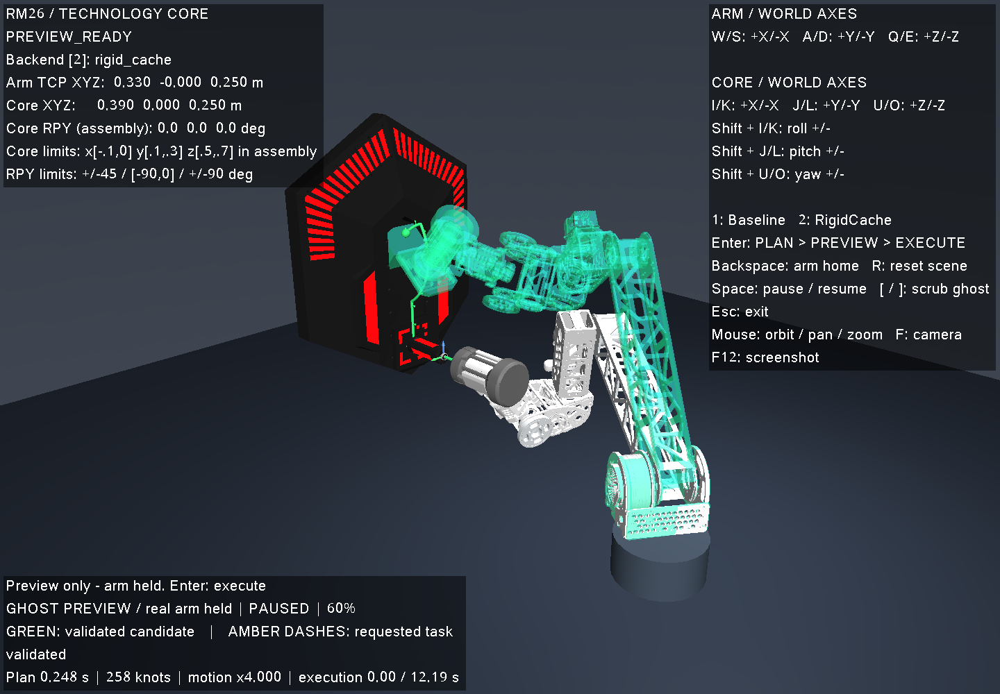
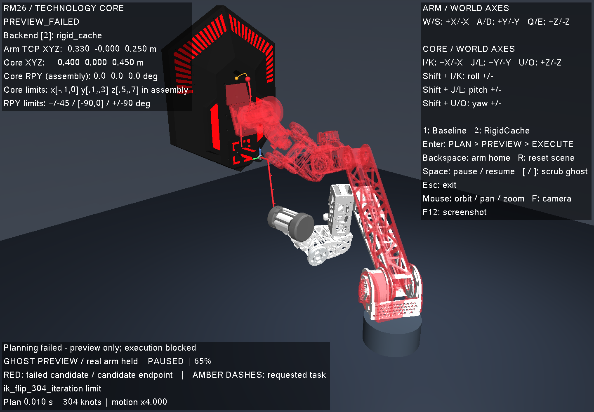

# 键盘规划 Demo：调整 → 预览 → 执行

`rm26_demo` 在同一个窗口中显示 RM26 机械臂、已固定夹持的能量单元和科技核心。可以分别调整机械臂末端与核心位姿，切换两个已有规划后端，先像 MoveIt2 一样用半透明机械臂虚影回放三级装配轨迹，再明确开始仿真执行。虚影同时显示携带单元和核心运动机构，实体机械臂与机构在预览期间保持不动。

## 启动

```bash
cmake -S . -B build -DCMAKE_BUILD_TYPE=Release
cmake --build build -j4
./scripts/run_planning_demo.sh
```

需要原项目的 MuJoCo、Eigen3、GLFW、OpenGL、libpng 依赖。脚本固定使用 CPU 与 Mesa/llvmpipe，设置空 `CUDA_VISIBLE_DEVICES`、软件 GLX 和 4 个渲染线程。启动时输出实际 renderer。自定义构建目录可运行：

```bash
RM26_DEMO_BINARY="$PWD/build-demo/rm26_demo" ./scripts/run_planning_demo.sh
```

交互需要可见的桌面 `DISPLAY`。没有 `DISPLAY` 时脚本会创建不可见的 Xvfb 窗口，用于有限时长的检查及截图：

```bash
./scripts/run_planning_demo.sh --duration 2 \
  --screenshot artifacts/keyboard_planning_demo/initial.png
```

`TECH_CORE_VIEWER=OFF` 构建保留可调用的控制器和测试，不生成窗口程序。

## 按键

| 功能 | 正方向 / 负方向 |
| --- | --- |
| 机械臂末端 X | W / S |
| 机械臂末端 Y | A / D |
| 机械臂末端 Z | Q / E |
| 核心 X | I / K |
| 核心 Y | J / L |
| 核心 Z | U / O |
| 核心 roll | Shift+I / Shift+K |
| 核心 pitch | Shift+J / Shift+L |
| 核心 yaw | Shift+U / Shift+O |
| 后端 1 / 后端 2 | 1：Baseline / 2：RigidCache（默认） |
| 规划并展示 / 执行已展示轨迹 | 第一次 Enter / 预览成功后再次 Enter |
| 机械臂与装配机构归零，保留核心位姿 | Backspace（退格键） |
| 恢复整个初始场景 | R |
| 虚影预览或实际执行暂停 / 继续 | Space |
| 虚影前后查看（每次 5%，并暂停预览） | [ / ] |
| 旋转 / 平移 / 缩放视角 | 鼠标左键 / 右键 / 滚轮 |
| 恢复视角 / 截图 / 退出 | F / F12 / Esc |

平移都使用同一世界坐标系，不随相机改变。机械臂控制点是携带单元开口中心 `planning_tcp`，保留开始 jog 时的朝向；松键立即保持。默认机械臂速度 0.06 m/s，核心速度 0.04 m/s，核心角速度 20°/s。

核心 RPY 按装配坐标系的 `Rz(yaw) Ry(pitch) Rx(roll)` 表示，对应旧 API 的 `alpha`、`phi−90°`、`theta`。核心原点是初始 E 点。沿用规划场景的规则表范围：装配坐标系 x∈[−0.1,0]、y∈[0.1,0.3]、z∈[0.5,0.7] m；roll∈[−45°,45°]、pitch∈[−90°,0°]、yaw∈[−90°,90°]。超过范围时停在边界，界面给出提示。默认核心处于最低高度、pitch=0°，因此先按 U 升高才能向下移动，先按 Shift+L 减小 pitch 才能增加回来。

**Backspace 的“归零”指回到程序启动时的待装配姿态**，并将插入、升降、P、Q 进度清零；七个关节不是全 0 rad。使用现有 `dev_nominal` 的起始携带姿态，默认 Q 目标 +35°。需要恢复核心的初始位姿时按 R。

## 两次回车与轨迹显示

1. 调整场景，选择 `1` 或 `2`，按 Enter 开始规划。计算使用独立线程和独立 MuJoCo model/data，窗口仍可旋转视角。
2. 计算结束进入 `PREVIEW_READY` 或 `PREVIEW_FAILED`。机械臂、核心机构和执行时钟都保持原状态，直到下一次明确按键。
3. 成功轨迹用绿色半透明机械臂虚影循环回放，并显示绿色路径与稀疏的目标轴向箭头。虚影使用独立 MuJoCo model/data，仅复制渲染几何叠加到画面中。再次按 Enter 才进入 `EXECUTING`，此时虚影隐藏，实体机械臂与核心机构同步执行。
4. 失败候选用红色虚影回放返回的关节轨迹或已求解前缀，底部显示原始失败原因。失败前缀没有时间戳时，只给虚影副本生成时间戳，不修改原规划结果、不解除执行限制。黄色虚线始终表示**请求的任务路径**。如果规划在起点碰撞或前平面检查处被拒绝，可能没有任何候选关节点；此时虚影保持起点，并显示请求路径、红色起点标记和“没有候选”的说明。红色终点标记表示候选路径终点，不保证就是首次碰撞位置。
5. 失败轨迹不能执行；按 Enter 保留预览并提示原因。修改场景或按 Backspace 后可重新规划。

长按 Enter 的重复事件、计算期间额外按 Enter 均不会排队触发执行。移动机械臂、调整核心、切换到另一个后端或回零，都会清除已有预览；后台旧请求即使成功也会被丢弃。后台至多一个请求，旧请求尚未返回时会提示稍后重新按 Enter。

虚影默认以 6 秒浏览整个候选，在末尾停留 1 秒后循环；这只改变预览播放速度。按 Space 暂停/继续虚影，按 `[` / `]` 前后查看轨迹。界面显示 `GHOST PREVIEW / real arm held` 和百分比。实际执行仍使用规划结果的原时间戳，不使用这个 6 秒预览时钟。

成功预览：白色实体机械臂保持起点，绿色半透明机械臂处于轨迹中段。



失败预览：红色虚影展示已求解前缀，实体机械臂仍保持起点，失败原因保留在下方。



执行中按 Space 暂停，窗口失焦也会暂停；重新聚焦后需 Space 继续。执行、暂停和完成状态下，位姿调整和后端切换锁定，先按 Backspace 回到可编辑状态。归零立即恢复仿真初始关节，是交互复位，不是一条规划回程轨迹。

## 规划与仿真范围

后端 1 复用 HKUST 任务雅可比基线；后端 2 复用现有 `RigidCache` 方案。二者采用相同任务、碰撞和规则验证接口。Demo 默认规划超时 5 s、`motion_speed_scale=4`，保留最终 0.5 s 规则驻留；这些是 Demo 的显式选项，没有修改规划库默认值。

成功后按照验证器相同的 `3u²−2u³` 插值关节及机构状态，精确到达最终路径点。这里的“执行”是 MuJoCo 中的运动学仿真，能量单元保持既定固定抓持变换；没有硬件控制或接触力控制。手动 jog 只受关节限位与速度限制，规划阶段才验证完整路径及碰撞。沿用现有 [碰撞几何与抓持假设](planning_scene_audit.md)，不把离散采样验证解释为连续碰撞证明。

可选参数见 `./build/rm26_demo --help`，例如：

```bash
./scripts/run_planning_demo.sh --backend baseline --motion-speed-scale 1
./scripts/run_planning_demo.sh --case confirm_top
./scripts/run_planning_demo.sh --case reject_front_plane
```

后两条用于查看普通失败与零关节点失败，仍需手动按 Enter。

## 代码与验证

- `include/tech_core/planning_demo.hpp` / `src/planning_demo.cpp`：不依赖窗口的异步规划、预览、失效及执行状态机，可调用 `PlanningDemo`。
- `src/planning_demo_main.cpp`：GLFW 按键、相机、独立虚影场景、轨迹几何、状态面板和 PNG 截图。
- `tests/planning_demo_test.cpp`：真实后端、两次回车、状态保持、虚影隔离与失败前缀计时、失效、超时/失败展示、插值、暂停及完整执行测试。
- `scripts/test_planning_demo_keyboard.py`：X11/XTest 向真实窗口注入按键并核验事件、截图和终态。

复现：

```bash
CUDA_VISIBLE_DEVICES='' ctest --test-dir build --output-on-failure -j4
xvfb-run -a -s '-screen 0 1440x1000x24 -nolisten tcp' \
  python3 scripts/test_planning_demo_keyboard.py --binary build/rm26_demo \
  --output artifacts/keyboard_planning_demo/my-x11-run
```

键盘测试输出必须使用新目录；子进程限时且在异常时终止，释放按键、X11 连接及 Xvfb 临时资源。启动脚本将事件记录到 `artifacts/keyboard_planning_demo/viewer.log`，每 1 MiB 轮转，最多两份备份；`--log` 可指定其他路径。F12 默认写 `artifacts/keyboard_planning_demo/screenshot.png`，`--screenshot` 可指定路径，指定后退出时也会截图。

2026-10-11 验证记录见 [运行时证据](evidence/keyboard_planning_demo.json)：窗口配置 23 项 CTest 通过，加入虚影后的 3 项 Demo 测试再次通过；无窗口配置 21 项通过。X11/XTest 检查了所有平移/旋转按键、长按 Enter、两个后端、虚影播放/暂停/前后查看、实体保持、完整执行、失焦暂停及旧规划失效。名义成功轨迹 258 点、执行时长 12.190568 s；失败示例分别保留 304 点前缀和 0 点早期拒绝。渲染为 llvmpipe，启动、执行和退出的 NVIDIA 进程表中均没有 Demo 进程。
