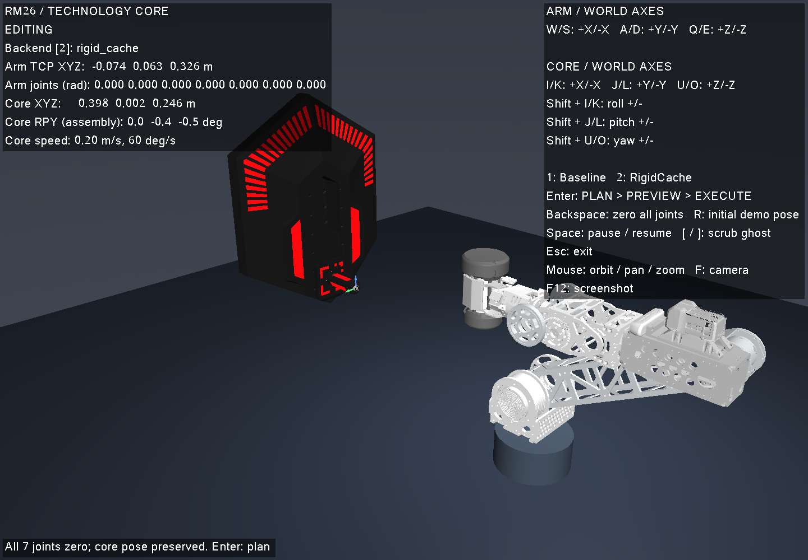

# 键盘规划 Demo：调整 → 预览 → 执行

`rm26_demo` 在同一个窗口中显示 RM26 机械臂、已固定夹持的能量单元和科技核心。可以分别调整机械臂末端与核心位姿，切换两个已有规划后端，先像 MoveIt2 一样用半透明机械臂虚影回放三级装配轨迹，再明确开始仿真执行。虚影同时显示携带单元和核心运动机构，实体机械臂与机构在预览期间保持不动。

## 启动

```bash
cmake -S . -B build -DCMAKE_BUILD_TYPE=Release
cmake --build build -j4
./scripts/run_planning_demo.sh
```

需要原项目的 MuJoCo、Eigen3、GLFW、OpenGL、libpng 依赖。脚本固定使用 CPU 与 Mesa/llvmpipe，设置空 `CUDA_VISIBLE_DEVICES`、软件 GLX 和 4 个渲染线程。启动时输出实际 renderer。自定义构建目录可运行：

```bash
RM26_DEMO_BINARY="$PWD/build-demo/rm26_demo" ./scripts/run_planning_demo.sh
```

交互需要可见的桌面 `DISPLAY`。没有 `DISPLAY` 时脚本会创建不可见的 Xvfb 窗口，用于有限时长的检查及截图：

```bash
./scripts/run_planning_demo.sh --duration 2 \
  --screenshot artifacts/keyboard_planning_demo/initial.png
```

`TECH_CORE_VIEWER=OFF` 构建保留可调用的控制器和测试，不生成窗口程序。

## 按键

| 功能 | 正方向 / 负方向 |
| --- | --- |
| 机械臂末端 X | W / S |
| 机械臂末端 Y | A / D |
| 机械臂末端 Z | Q / E |
| 核心 X | I / K |
| 核心 Y | J / L |
| 核心 Z | U / O |
| 核心 roll | Shift+I / Shift+K |
| 核心 pitch | Shift+J / Shift+L |
| 核心 yaw | Shift+U / Shift+O |
| 后端 1 / 后端 2 | 1：Baseline / 2：RigidCache（默认） |
| 规划并展示 / 执行已展示轨迹 | 第一次 Enter / 预览成功后再次 Enter |
| 七个关节角度全部归零，装配进度清零，保留核心位姿 | Backspace（退格键） |
| 载入装配演示预设（非零关节角）和预设核心位姿 | R |
| 虚影预览或实际执行暂停 / 继续 | Space |
| 虚影前后查看（每次 5%，并暂停预览） | [ / ] |
| 旋转 / 平移 / 缩放视角 | 鼠标左键 / 右键 / 滚轮 |
| 恢复视角 / 截图 / 退出 | F / F12 / Esc |

平移都使用同一世界坐标系，不随相机改变。机械臂控制点是携带单元开口中心 `planning_tcp`，保留开始 jog 时的朝向；松键立即保持。默认机械臂速度 0.06 m/s，核心速度 **0.20 m/s**，核心角速度 **60°/s**。核心平移、旋转速度可分别通过 `--core-speed`（m/s）、`--core-rotation-speed`（°/s）调整，均接受正的有限数值。

核心 RPY 按装配坐标系的 `Rz(yaw) Ry(pitch) Rx(roll)` 表示，对应旧 API 的 `alpha`、`phi−90°`、`theta`。核心原点是初始 E 点。**Demo 中核心 XYZ 和 RPY 均不设位姿限位，规划也不再受装配站前平面限制**，可以直接向任意方向调整，角度可连续累加。规划使用当前实际位姿；无法到达或碰撞时，仍展示请求路径、返回的候选轨迹及失败原因。

**启动和 Backspace 均使用上游 URDF 的七关节零位 `[0,0,0,0,0,0,0]` rad**。Backspace 同时将插入、升降、P、Q 进度和执行时钟清零，清除预览并使旧规划请求失效，保留当前核心 XYZ/RPY 与后端。零位保留上游关节的固定安装变换，因此模型呈折叠姿态。来源是 [HKUST RM26 version3](https://github.com/HKUSTGZ-ROBOMASTER-PNX/UpperComputerControlOpenSourceDoc/tree/6edc630a1a14a3904b42d5a360e9020562eefc99/src/RM/RMController/core/models/rm26_version3_engineering_model)；2026-10-11 在线核对 `main` 仍指向该提交，本地 `source.urdf` 与上游逐字节一致。

**R 单独载入装配演示预设**，包括非零携带姿态和预设核心位姿，后端保留；这不是机械臂零位。默认使用 `dev_nominal`，最后的 Q 旋转按左右两侧实际可达范围规划。可直接从零位按 Enter 规划，也可先按 R 查看名义装配演示。界面显示七个关节的实际角度：



## 两次回车与轨迹显示

1. 调整场景，选择 `1` 或 `2`，按 Enter 开始规划。计算使用独立线程和独立 MuJoCo model/data，窗口仍可旋转视角。
2. 计算结束进入 `PREVIEW_READY` 或 `PREVIEW_FAILED`。机械臂、核心机构和执行时钟都保持原状态，直到下一次明确按键。
3. 成功轨迹用绿色半透明机械臂虚影循环回放，并显示绿色路径与稀疏的目标轴向箭头。虚影使用独立 MuJoCo model/data，仅复制渲染几何叠加到画面中。再次按 Enter 才进入 `EXECUTING`，此时虚影隐藏，实体机械臂与核心机构同步执行。
4. 失败候选用红色虚影回放返回的关节轨迹或已求解前缀，底部显示原始失败原因。失败前缀没有时间戳时，只给虚影副本生成时间戳，不修改原规划结果、不解除执行限制。黄色虚线始终表示**请求的任务路径**。如果规划因起点碰撞等原因提前被拒绝，可能没有任何候选关节点；此时虚影保持起点，并显示请求路径、红色起点标记和“没有候选”的说明。红色终点标记表示候选路径终点，不保证就是首次碰撞位置。
5. 失败轨迹不能执行；按 Enter 保留预览并提示原因。修改场景或按 Backspace 后可重新规划。

长按 Enter 的重复事件、计算期间额外按 Enter 均不会排队触发执行。移动机械臂、调整核心、切换到另一个后端或回零，都会清除已有预览；后台旧请求即使成功也会被丢弃。后台至多一个请求，旧请求尚未返回时会提示稍后重新按 Enter。

虚影默认以 6 秒浏览整个候选，在末尾停留 1 秒后循环；这只改变预览播放速度。按 Space 暂停/继续虚影，按 `[` / `]` 前后查看轨迹。界面显示 `GHOST PREVIEW / real arm held` 和百分比。实际执行仍使用规划结果的原时间戳，不使用这个 6 秒预览时钟。

成功预览：白色实体机械臂保持起点，绿色半透明机械臂处于轨迹中段。


失败预览：红色虚影展示已求解前缀，实体机械臂仍保持起点，失败原因保留在下方。


执行中按 Space 暂停，窗口失焦也会暂停；重新聚焦后需 Space 继续。执行、暂停和完成状态下，位姿调整和后端切换锁定，按 Backspace 或 R 回到可编辑状态。Backspace 立即将七个仿真关节置零，是交互复位，不是一条规划回程轨迹。

## 规划与仿真范围

后端 1 使用六行任务雅可比 Baseline；后端 2 使用五维任务及预测步 RigidCache。当前两个后端都启用附近姿态搜索、有界 QP 失败恢复，以及相同的刚体配对和精确状态碰撞缓存；后端名称不能再解释为“只有 2 使用缓存”。二者采用相同任务、碰撞和规则验证接口。Demo 默认规划超时 5 s、`motion_speed_scale=4`，保留最终 0.5 s 规则驻留。Demo 的场景设置 `enforce_core_pose_limits=false`，跳过规则表位姿范围和前平面检查；规划库其他调用默认保留这两项检查。规划的关节限位、碰撞和装配过程验证继续生效。

规划首先对插入起始点 E 的外法向前方 **40 mm** 处做逆解，位置为 `p_pre = p_E + 0.04 * outward_axis`，工具轴与插入轴对齐。两个后端都优先搜索接近实际起点的冗余解，重点减少末轴变化：尝试保持末轴角度，再向两侧逐步放开，并保留普通 IK 解。关节的等效整圈表示选为限位内接近起点的值；候选按 `sum(abs(q_goal-q_start)) + 3*abs(delta_q6)` 排序。所有种子来自本次实际状态、固定装配预设、关节范围中心和固定随机种子的扰动，不读取已保存的逐位姿解。

候选首先通过插入、升降、P 阶段的在线连续逆解与碰撞筛查，再尝试接近连接和完整验证。候选搜索最多使用总预算的 25%，失败候选、重试和最终验证都计入同一超时。筛查只能提前拒绝，不能代替完整验收；筛查遗漏的碰撞仍由密集验证拒绝。这是有限时间内的启发式选择，不保证全局最小关节变化。名义零位起步的两个后端，预插入末轴变化由约 118° 降至 **28.6°**，七关节绝对变化之和由约 574° 降至 **455.6°**。界面的 `Pre-insert change` 显示这两个量，事件日志也保留原始值。详见 [大范围规划质量评测](planner_quality.md)。

**第一段采用带碰撞检查的路径搜索和缩短优化。** 先检查当前状态到目标解的直接连接；存在障碍时，用双向 RRT-Connect 在关节空间搜索绕行路径，再通过带碰撞检查的捷径缩短路径。机械臂、携带单元和场景都纳入检查，普通配对仍要求 1 mm 间距。每条边按最终轨迹相同的密集采样规则检查，拐点被保留；时间参数化继续使用现有速度、加速度上限和段内平滑。搜索与优化最多使用进入该段时剩余规划预算的 60%，为后续装配和完整验收留出时间。

到达预插入点后，继续原来的 40 mm 对准、100 mm 插入、升降、P/Q 旋转及驻留。黄色请求路径从预插入点开始；实际接近路径属于候选轨迹与虚影。若逆解或接近搜索失败，仍显示原因和请求路径；搜索中断时只预览从真实起点连通、已经检查过的前缀。第一次回车预览，第二次回车才执行完整的已验证轨迹。

装配段逆解使用 1 µm / 1 µrad 端点容差，并对关节插值造成的中间位姿误差自适应加点，避免端点正确而弦段侵入 0.1 mm 装配接触边界。普通碰撞间距和装配接触阈值保持原值。仅相对变换恒定的焊接刚体配对在固定参考姿态下计算距离，避免网格距离算法随世界旋转出现数值差异；打开或关闭缓存都使用相同几何约定。`PlanOptions::optimize_joint_motion=false` 可关闭姿态优化策略以做对照，固定刚体距离的正确性修复仍生效；底层 `solve_ik` 的 Baseline 默认参数保持不变。

**最后 Q 阶段向左右两侧尽量旋转。** Demo 对两个后端和所有预设启用 `q_sweep` 与 `q_best_effort`：从 0° 向 +90° 逐步求解。如果最近的 IK 解在下一段失去碰撞间距，先在位置与工具轴任务的两个冗余方向上尝试附近关节解，再重新求解到同一个 Q 目标；每次尝试仍须通过原密度的整段碰撞与跟踪检查，已经验证的前缀和预插入姿态保持不变。局部扰动半径依次为 0.025、0.05、0.1、0.2 rad，两侧合计最多占用本次候选规划预算的 15%，并继续为整条路径最终复验预留时间。

IK、关节限位、跟踪误差、无法绕开的碰撞或预算限制仍会使该侧停在最后完整验证通过的角度；沿正向关节路径返回 0°，再向 −90° 逐步求解。默认每步 1°，失败的区间不加入执行轨迹。机构行程保持 −90°～+90°，最后在实际负向终点驻留 0.5 s；某侧只能转一部分或不能转动，也可以保留已完整验收的轨迹。插入、升降、P 翻转仍必须完整通过。局部换解随 `optimize_joint_motion` 一同启用，只用于 Baseline/RigidCache 的 best-effort Q；不能保证找到所有冗余分支中的最大行程。

预览面板显示 `Validated Q: 0 -> +... -> 0 -> ... deg`，分别列出 `Q+ stop`、`Q- stop`；`travel_limit` 表示到达机构行程，`online_budget` 表示预算已用完，其他原因保留具体 IK 或碰撞信息。两侧实际范围与停止原因也写入事件日志。黄色请求路径表示期望的完整 ±90° 行程，绿色虚影和第二次回车执行的轨迹表示实际通过验证的范围。这个范围取决于当前位姿、找到的逆解分支及规划时间；预算用完的角度不表示机械极限。`--timeout` 可调整本次规划预算。普通规划库调用仍按调用方的 `Scenario` 选择固定角度、严格往返或尽量旋转。

局部换解修复了核心世界 XYZ `(0.14, 0, 0.22)` m、RPY `(6, −51, −66)`° 时在 +20°/+21° 提前停下的问题：两个后端现在均转满 ±90°，预插入末轴仍不转动。复现输入及独立审计见 [Q 换解验证](q_collision_recovery.md)。

成功后按照验证器相同的 `3u²−2u³` 插值关节及机构状态，精确到达最终路径点。这里的“执行”是 MuJoCo 中的运动学仿真，能量单元保持既定固定抓持变换；没有硬件控制或接触力控制。手动 jog 只受关节限位与速度限制，规划阶段才验证完整路径及碰撞。沿用现有 [碰撞几何与抓持假设](planning_scene_audit.md)，不把离散采样验证解释为连续碰撞证明。

可选参数见 `./build/rm26_demo --help`，例如：

```bash
./scripts/run_planning_demo.sh --backend baseline --motion-speed-scale 1
./scripts/run_planning_demo.sh --core-speed 0.3 --core-rotation-speed 90
./scripts/run_planning_demo.sh --case confirm_top
./scripts/run_planning_demo.sh --case reject_blocked
```

后两条用于查看普通失败与零关节点失败，启动后按 R 载入对应场景的装配预设，再按 Enter。

## 代码与验证

- `include/tech_core/planning_demo.hpp` / `src/planning_demo.cpp`：不依赖窗口的异步规划、预览、失效及执行状态机，可调用 `PlanningDemo`。
- `src/planning_demo_main.cpp`：GLFW 按键、相机、独立虚影场景、轨迹几何、状态面板和 PNG 截图。
- `tests/planning_demo_test.cpp`：真实后端、两次回车、状态保持、虚影隔离与失败前缀计时、失效、超时/失败展示、插值、暂停及完整执行测试。
- `src/planning_approach.cpp` / `tests/planning_approach_test.cpp`：碰撞感知接近搜索、捷径优化、零位回归、障碍物绕行、密集无缓存复查和中断前缀检查。
- `scripts/test_planning_demo_keyboard.py`：X11/XTest 向真实窗口注入按键并核验事件、截图和终态。

复现：

```bash
CUDA_VISIBLE_DEVICES='' ctest --test-dir build --output-on-failure -j4
xvfb-run -a -s '-screen 0 1440x1000x24 -nolisten tcp' \
  python3 scripts/test_planning_demo_keyboard.py --binary build/rm26_demo \
  --output artifacts/keyboard_planning_demo/my-x11-run
```

键盘测试输出必须使用新目录；子进程限时且在异常时终止，释放按键、X11 连接及 Xvfb 临时资源。启动脚本将事件记录到 `artifacts/keyboard_planning_demo/viewer.log`，每 1 MiB 轮转，最多两份备份；`--log` 可指定其他路径。F12 默认写 `artifacts/keyboard_planning_demo/screenshot.png`，`--screenshot` 可指定路径，指定后退出时也会截图。

2026-10-11 的初版记录见 [初版运行时证据](evidence/keyboard_planning_demo.json)。归零与核心自由调节修正后的记录见 [修正验证](evidence/keyboard_zero_free_core.json)：重新构建默认 `build/rm26_demo`，23 项 CTest 全部通过；真实窗口的 X11/XTest 回归也通过，覆盖七关节精确归零、R 恢复非零初始姿态、核心以新速度越过旧范围、越界请求的失败预览，以及完整的预览/执行流程。控制器另验证 XYZ/RPY 的全部正负方向均不再限位、规划从零关节启动、旧规划结果不能覆盖归零状态，其他场景的默认范围检查仍生效。截图已更新。渲染为 llvmpipe，启动、执行和退出的 NVIDIA 进程表中均没有测试 Demo 进程，测试窗口和 Xvfb 已退出。

同日进一步将启动姿态统一到上游 URDF 零位，记录见 [上游零位与启动验证](evidence/keyboard_urdf_zero.json)：在线核对上游提交与 URDF 哈希，独立 URDF/MuJoCo 的 68 组 FK 再次通过；规划场景的七主关节原点、轴向、范围和零参考保持一致。附加夹爪仍使用装配 Demo 既有的固定夹持角，详见 [夹持约定](planning_scene_audit.md)。重建后 3 项 Demo 测试及完整真实键盘回归通过，截图更新为启动即七关节全零；R 明确标为装配预设。

同日移除 Demo 规划入口的前平面限制，记录见 [前平面限制移除验证](evidence/keyboard_no_front_plane.json)：23 项 CTest 和完整真实键盘回归通过。Baseline、RigidCache 均能对越过原前平面的核心位姿继续规划并展示结果；窗口测试中的该位姿因起点碰撞失败，保留请求路径与起点虚影，第一次回车及预览期间实体保持不动，失败结果不能执行。正常预设仍可在第二次回车后执行到完成。零关节点失败的窗口用例改用 `reject_blocked`；此前记录中的 `invalid_station_front_plane` 是修改前的历史结果。

此前的直接逆解与关节线性接近版本记录见 [接近段验证](evidence/keyboard_direct_preinsert.json)：当时 23 项 CTest 和真实键盘回归通过，名义装配预设可执行，但默认全零初值在 RigidCache 下出现 `ik_preinsert_no descending feasible step`。这份记录对应优化接近段之前的版本。

带碰撞检测的接近优化记录见 [优化接近段验证](evidence/keyboard_optimized_approach.json)：24 项 CTest 和完整真实键盘回归通过。原零位场景中，Baseline 的首个 IK 解本身存在自碰，RigidCache 的首个初值不收敛；新的筛选流程在两次 IK 尝试后为两个后端找到可用解，各生成 364 个轨迹点。窗口中完整规划实测约为 Baseline 1.50 s、RigidCache 0.74 s；第一次回车保持实体零位，第二次回车后的零位起步仿真执行到 `COMPLETE`。额外障碍物测试确认直连被阻挡、搜索得到绕行路径、捷径优化缩短关节路径，并通过 0.002 rad 步长且关闭缓存的复查；中断只返回起点侧已检查前缀。

最后 Q 阶段改为双向尽量旋转，记录见 [双向 Q 验证](evidence/keyboard_best_effort_q.json)：24 项 CTest 与完整真实键盘回归通过。名义场景中，Baseline、RigidCache 从七关节零位和装配预设起步，均生成 `0° → +90° → 0° → −90°` 的有效轨迹；RigidCache 的两次窗口执行均达到 `COMPLETE`，实际机构 Q 停在 −90°。控制器测试另检查执行经过正向峰值，并对两个后端的完整轨迹进行无缓存复查。已有碰撞回归场景停在 +63° 后转向，仍到达 −90°，验证“只能转一部分”不会使整条轨迹失效。窗口使用 llvmpipe，四次 NVIDIA 进程快照均没有测试 Demo 进程，测试窗口和 Xvfb 已退出。
