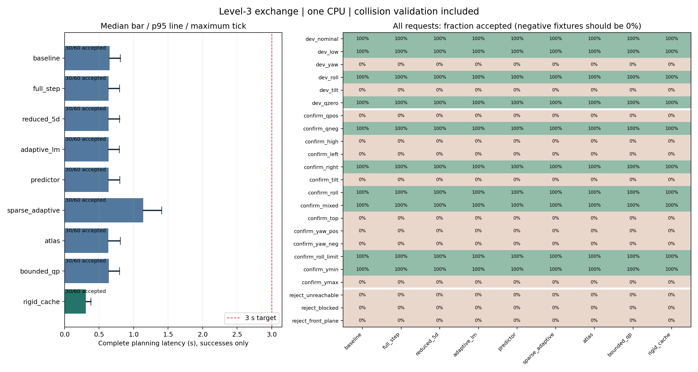
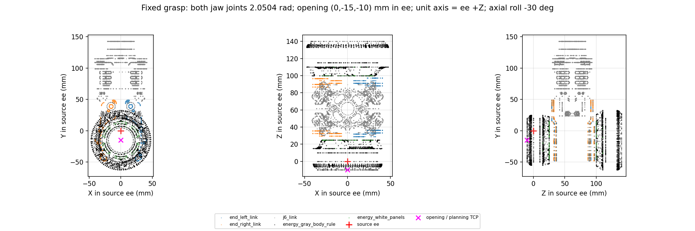

# 三级兑换规划：基线、八种加速方案与冻结评测

在单个 CPU 线程上，完整成功的三级兑换轨迹已达到 **单次规划小于 3 s**：HKUST 算法适配基线的中位数为 **0.650992 s**；推荐的 `rigid_cache` 为 **0.308516 s**，P95 **0.378431 s**，最大 **0.379631 s**。同场景、同重复的配对中位减时为 **53.22%**（2.138 倍加速），没有达到减少 90%。基线本身已满足 3 s，报告没有人为放慢基线。

**覆盖限制同样属于结论：20 个正例场景中仅 10 个完成，正例成功率 50%；八个候选和基线成功集合相同。** 所有成功记录均完成插入、升降、P 上翻、Q 到角、驻留及规则确认；失败记录没有按成功或“更快”处理。当前实现沿固定任务路径跟踪，遇到碰撞或局部 IK 失败即拒绝，尚不具备全局绕障及 IK 分支恢复能力。



左图只统计完整成功请求；右图保留全部 23 个场景，末三行是应当拒绝的负例。图的 [PDF 版本](images/level3-planning-results.pdf) 可直接导出使用。

## 实验对象和计时边界

| 项目 | 冻结配置 |
| --- | --- |
| 本地实现提交 | `afc7f852771289c2070f642eda5e51613e1212a0` |
| 上游参考提交 | `6edc630a1a14a3904b42d5a360e9020562eefc99` |
| CPU / 运行配置 | AMD EPYC 9555 64-Core；固定逻辑 CPU 0；单线程；无 GPU、无渲染器 |
| C++ / 仿真后端 | GCC 11.4.0，Release `-O3 -DNDEBUG`；MuJoCo 3.3.7；Eigen |
| 冻结评测时间 | 2026-10-10 17:36:46–17:45:32 UTC，即北京时间 2026-10-11 01:36:46–01:45:32 |
| 任务集合 | 6 个 development、14 个 confirmation、3 个 negative；每方法每场景重复 3 次 |
| 总体 | 9 × 23 × 3 = **621 条**，无缺失、重复、超时或未完成进程 |
| 模型冷加载 | **0.646598 s**，单列 |
| Atlas 离线构建 | **2.360816 s**，6 个开发请求中 4 个有效模板，单列 |
| 模拟运动约束 | 关节速度 ≤1 rad/s、加速度 ≤2 rad/s²；不是实物规格标定 |

`planning_seconds` 从每次 `PlanningScene::configure()` 前计时，到完整轨迹通过在线验证并返回为止，包含场景配置、初始有效性检查、任务采样、在线模板查找、IK、时间参数化、碰撞检查及规则验证。`rigid_cache` 每次请求清空缓存，首次填充包含在该计时内。

模型加载、Atlas 建库与额外密采样复查单独计时；CSV 写出和机械臂执行不计入规划。轨迹时间戳及独立审计记录了参数化执行时长。请求上限为 30 s，本批次没有触及；3 s 结论来自实测完整成功耗时。名义基线轨迹的参数化**执行时间为 47.254822 s**，与约半秒的规划 CPU 时间是两个量。

基准包装脚本固定线程环境和 CPU 亲和性，交错轮换方法次序。完整环境、命令、终态及 45 个源码/配置哈希见 [environment.json](evidence/level3_planning/environment.json)。执行文件 SHA-256 为 `06bc3d0a863960dc917eb9b4294267cf65e13fc36b690f8304051fff0a4b6021`。154 个实际加载网格还逐一核对了冻结 Git 提交和 SHA-256，见 [manifest.json](evidence/level3_planning/manifest.json)。本报告及证据整理未修改冻结运行实现或几何。

## 基线及八种实际运行的方案

上游实现的是释放工具轴自转的任务雅可比 IK，以及沿给定点列逐点 warm start。任务矩阵为 `Jtask = [Jv; (I-aaᵀ)Jω]`，误差为 `[pd-p; a×ad]`，采用六行 LDLT 阻尼最小二乘。基线保留 λ=1e-4（正则项为 λ²）、α=0.2、300 次上限、位置/轴角各 1e-4 容差、关节限位、反向轴特判及失败即停止的语义。

本地以 MuJoCo FK/Jacobian 替代 Pinocchio，控制点换为实际携带单元开口；三级路径、碰撞与动态限值时间化是共同包装层扩展。**没有构建或运行上游 ROS/Pinocchio 包**，不把下表称为上游软件原机耗时。46 个上游文件已按固定 SHA 归档并校验；逐项对应和许可证边界见 [参考审计](planning_reference.md)。

下表均为每方法 **30 条完整成功正例**的规划耗时，单位秒。减时按每个成功配对的 `1 - t_method/t_baseline` 再取中位数计算；不能用失败很快返回来增加加速成绩。

| 方法 | 实际实现 | P50 | P95 | 最大 | 配对中位减时 |
| --- | --- | ---: | ---: | ---: | ---: |
| `baseline` | 上述六行投影任务雅可比 DLS + 顺序 warm start | 0.650992 | 0.804760 | 0.806777 | — |
| `full_step` | α=1，回溯线搜索 | 0.637680 | 0.791663 | 0.794564 | 1.80% |
| `reduced_5d` | 轴切空间五维任务、5×5 LLT、信赖步长 | 0.637521 | 0.793094 | 0.794722 | 1.82% |
| `adaptive_lm` | 自适应阻尼 LM + 线搜索 | 0.637551 | 0.791351 | 0.792272 | 1.80% |
| `predictor` | Jacobian 预测下一点，再以 Reduced5D 校正 | 0.637522 | 0.791967 | 0.797598 | 1.85% |
| `sparse_adaptive` | 12 mm / 5° 粗节点，四分点误差/碰撞检查，最多 8 轮细分 | 1.138311 | 1.400605 | 1.404483 | **−74.19%** |
| `atlas` | 仅开发集离线轨迹增量模板，在线迁移并 IK 校正 | 0.635031 | 0.798507 | 0.803601 | 1.63% |
| `bounded_qp` | 七变量 active-set box QP，将限位与步长边界纳入子问题 | 0.638956 | 0.791754 | 0.794757 | 1.76% |
| **`rigid_cache`** | Predictor IK + 同刚体距离缓存 + 平面 AABB 下界 + 单状态支持值复用 | **0.308516** | **0.378431** | **0.379631** | **53.22%** |

基线成功记录中，在线验证占规划时间比例的中位数为 **97.71%**；IK 中位耗时仅 **14.59 ms**。Predictor 将 IK 降至约 **1.55 ms**，而总耗时几乎不变。因此只优化 IK 无法带来 90% 的完整规划减时。

稀疏方法确实减少主节点，但四分点校正、细分和碰撞检查成本更高，最终比基线慢。其 `ik_seconds` 包括细分中的检查成本，不是纯线性代数时间。Atlas 在线 IK 中位约 1.35 ms，却无法消除主验证开销；其开发成绩可使用同场景模板，confirmation 不参与建库。这里的 confirmation 是固定确认集合，不宣称是从未接触过的统计留出集。

`rigid_cache` 是组合方案，没有单独 baseline+cache 的消融。仅同 `body_weldid`、相对位姿固定的几何对跨状态缓存，缓存键包含距离 cutoff；装配轴支持极值只在一个碰撞状态内复用，每次新状态失效。平面剔除使用完整几何世界 AABB 的保守分离下界。在线共记录 **180,194,952 次**刚体缓存命中，其余方法为零；额外 dense 复查关闭该缓存。相关数学条件和实现失效边界已审查，见 [源码审查](planning_review.md)。

## 全量成功率与失败原因

| 集合 | 每方法不同场景完成数 | 每方法重复请求结果 | 九方法总结果 |
| --- | ---: | ---: | ---: |
| development | 4/6 | 12/18 成功 | 108/162 成功 |
| confirmation | 6/14 | 18/42 成功 | 162/378 成功 |
| 正例合计 | **10/20** | **30/60 成功** | **270/540 成功** |
| negative | 0/3 被接受 | 9/9 正确拒绝 | **81/81 正确拒绝** |

八种方案没有成功率回归，也没有扩大成功集合。成功的场景为 `dev_nominal`、`dev_low`、`dev_roll`、`dev_qzero`、`confirm_qneg`、`confirm_right`、`confirm_roll`、`confirm_mixed`、`confirm_roll_limit`、`confirm_ymin`。

基线失败分类如下；所有候选最终接受/拒绝集合相同，但失败节点及具体诊断可能不同：

| 正例失败场景 | 基线原因 |
| --- | --- |
| `dev_yaw`、`confirm_qpos`、`confirm_high`、`confirm_left`、`confirm_yaw_pos`、`confirm_ymax` | Approach 阶段 j2/j4 自碰间隙低于 1 mm |
| `dev_tilt`、`confirm_tilt`、`confirm_top` | P 上翻阶段局部 IK 达到迭代上限 |
| `confirm_yaw_neg` | Lift 阶段 j5 与核心外壳间隙低于 1 mm |

三类负例分别检验远距离不可达、真实阻挡盒导致起点碰撞、初始核心越前平面。全部 351 条失败/拒绝记录与实测耗时均保留在 [runs.csv](evidence/level3_planning/runs.csv)。拒绝不等于数学证明该正例不存在其他无碰撞路径；当前求解器没有搜索替代接近路径或冗余分支。

## 夹爪、能量单元与安装坐标

夹持采用实际 CAD 配合所得的固定刚体变换，不仿真夹紧过程。**原夹爪 q=0 接近张开**；本次固定左右关节为 **2.0504 rad**。单元开口在 `ee_link` 中为 **(0, −0.015, −0.010) m**，单元 +X 沿末端 +Z，再增加 **−30° 轴向滚转**使灰色筋条与爪接触部位配合。`T_ee_unit` 的四元数按 wxyz 为：

```text
(0.3535533905932738, -0.6123724356957945,
 -0.3535533905932738, -0.6123724356957945)
```

IK 控制 `planning_tcp`，其位置是物理孔口、+Z 是单元长轴；固定偏移同时进入 FK 与 Jacobian。开口、TCP 和 `ee_link` 不能互换。携带物的实际轴向自转由臂 FK 与固定变换共同确定，全程仍检查非轴对称外形。约 20 µm 的 CAD 名义接近间隙只用于定义此固定几何，不是实物抓持精度、夹持力或稳定性保证。



世界系为原机械臂 `base_link`；装配系原点取 **(0.30, 0.20, −0.25) m**、yaw=π，地面同步到 z=−0.25 m，即假设底座高出装配地面 250 mm。这是明确的本地安装假设，未经实物外参标定，原 URDF 运动链未改。

共同起点是仅由 nominal development 选定、位于 E 前约 60 mm 的持物 ready 位形：

```text
q_ready = [-0.62770373654521094, 2.3297993305507192,
            1.0289871622237392, 1.2715734368717495,
           -1.747192543846495, -0.81681197466957878,
            1.9772845777886507]
```

规划不包括资源区取物或原显示 home 到 ready；原 home 的直接 Cartesian 接近会自碰。完整配合推导、机构 P/Q 矩阵链、CAD 证据和这些假设见 [场景审计](planning_scene_audit.md) 与 [抓取来源](../reference/planning_upstream/GRASP_PROVENANCE.md)。

## 碰撞与三级完成验证

完整路径为 ready → 距 E 40 mm 的预插点 → E → 插入 100 mm → 升降 100 mm → P 上翻 90° → Q 到目标 → 驻留 0.5 s → confirm。Q 是使单元侧倾的机构自由度，不是单元自转。验证从实际臂 FK 反解机构状态，再送入 `AssemblyRules(3)`，没有直接用计划目标伪装实际观测。

联合场景含 **85 个臂凸分块、98 个空心单元代理、16 个活动核心几何、4 个固定障碍几何**。非相邻臂自碰、臂/携带物对核心及环境均受检查。相邻刚体连接、固定安装连接和已证明局限于外筒的指定夹爪接触对有明确名单；没有整体腕部、单元或柱的碰撞豁免。自由空间间隙取 1 mm，指定座合/抓持对允许最多 0.1 mm 数值穿深，孔柱另保留 0.5 mm 径向余量。

对指定近共面座合对，MuJoCo native CCD 曾产生约 −47 mm 的伪穿深；实现改用完整凸体的轴向支持面分离证书，仅在列明对上判定分离或不超过 0.1 mm 的去穿透平移。未扩大允许穿深，孔壁及未命名对继续正常检查；返回的 `CollisionResult.distance` 有时是支持面界，不总是精确欧氏最近距离。名义 2 mm 孔柱间隙、3 mm 径向错位拒绝、1 mm 轴向错误座合拒绝均有针对性测试。

时间参数化采用节点零速度三次曲线，速度和加速度按解析峰值核查。在线每段最少两个子步，并令 `n ≥ ceil(1.5 max|Δq|/0.008)`；dense 复查将最大关节步长减半、最少子步数加倍，重新配置场景且禁用刚体缓存。**它们仍是离散碰撞检查，不能保证样本间绝无碰撞。**

270 条成功轨迹全部通过在线检查和 dense 复查，无 `plan_success` 后被复查拒绝的情况。另一套 Python 审计从原始 URDF 重新计算 FK、固定抓取、机构目标、阶段、时间戳和运动峰值：

| 独立审计指标 | 全部成功轨迹结果 |
| --- | ---: |
| 独立 FK 样本 / 节点 | **422,364 / 69,987** |
| C++ dense 复查样本 | **408,645** |
| 最大开口位置误差 | **0.247172 mm**，门槛 0.5 mm |
| 最大轴角误差 | **0.000669951 rad**，门槛 0.002 rad |
| 最大关节速度 | **0.263836 rad/s** |
| 最大关节加速度 | **2 + 8.9e-14 rad/s²**，浮点误差范围 |
| 实际 FK 最短连续 Q 对准时长 | **0.575 s**，规则要求 0.4 s |
| 审计结果 | **valid=true，0 errors** |

这套独立审计**没有实现第二套网格碰撞算法**；碰撞证据来自在线检查、关闭缓存的密复查、几何专项测试及源码数学审查。最终 CTest **20/20 通过**，耗时 17.19 s，日志见 [ctest.log](evidence/level3_planning/ctest.log)。

几何近似还包括核心外壳的填实 AABB、名义规则柱替代不兼容的源磁铁凸起，以及相邻连接排除。48 段孔代理的内圆为外切多边形，角点半径最大 **20.0429134 mm**，比理想圆孔局部扩大 **42.9 µm**；不能声称整个空心实体完全保守。真实抓取、力控制、跟踪误差、薄障碍连续扫掠和实物坐标标定均不在此次已验证范围内。

## 复现和交付

仓库根目录执行，依赖 Eigen3、MuJoCo 3.3.7；独立审计另需 Python NumPy，可选作图需 Matplotlib。每次基准使用一个新的输出目录，保留失败记录：

```bash
cmake -S . -B build-planning -DCMAKE_BUILD_TYPE=Release -DTECH_CORE_VIEWER=OFF
cmake --build build-planning -j4
CUDA_VISIBLE_DEVICES='' ctest --test-dir build-planning --output-on-failure
python scripts/run_planning_benchmark.py --executable build-planning/rm26_plan \
  --output artifacts/level3_planning/my_run --method all --repeat 3 --dense-check
OPENBLAS_NUM_THREADS=1 python scripts/audit_planning_trajectories.py \
  artifacts/level3_planning/my_run --expected-runs 621
OPENBLAS_NUM_THREADS=1 python scripts/plot_planning_results.py \
  artifacts/level3_planning/my_run --output artifacts/level3_planning/my_run/results.png
```

公开内存调用入口是 [`plan(PlanningScene&, Scenario, PlanOptions)`](../include/tech_core/planning.hpp)，CMake 链接 `rm26_planning`；推荐 `Method::RigidCache`。每个工作线程使用自己的场景，请求期间几何必须不可变；仅 `result.success` 为真才可交出 `result.knots`，失败结果可能是前缀或被验证器拒绝的候选。README 提供最小调用示例。

完整原始输出保留在 `artifacts/level3_planning/frozen_621/`。入库证据位于 [docs/evidence/level3_planning](evidence/level3_planning/README.md)：包括 621 行运行记录、23 场景参数、各类计时、环境与冻结哈希、独立审计、测试日志，以及全部 621 个逻辑轨迹文件。归档将相同内容存为内部 tar 硬链接，168 份唯一内容压缩为 **5,213,124 字节**；每个逻辑文件均逐一按 manifest 校验，不删去重复或失败请求。具体校验、恢复与再次审计命令见证据目录说明。
