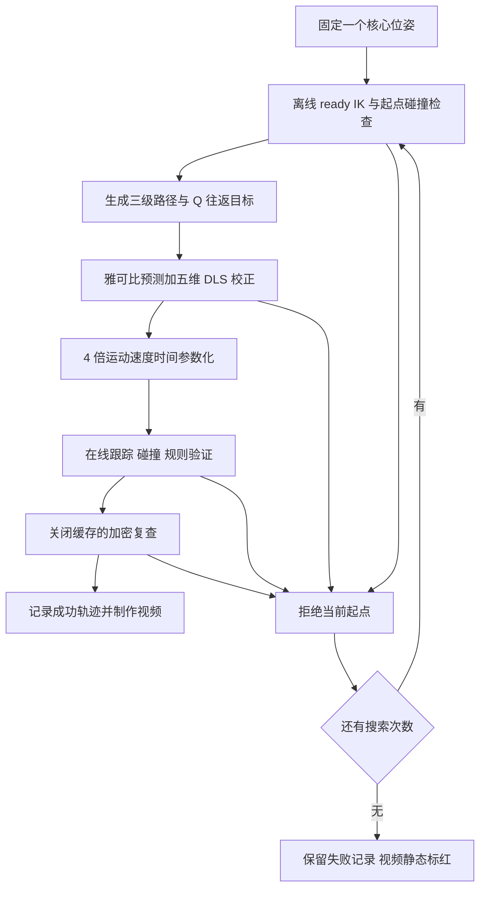

# 40 个科技核心位姿：Q 轴往返规划、算法与参数

后续按用户要求完成了[同一 40 位姿的在线重跑](pose40_online.md)：固定实际关节起点，3 s 总时限内包含在线重试、起点连接和密碰撞检查，20/40 成功。下面保留原离线 ready 搜索实验及其计时定义。

本次固定 40 个不同的六自由度核心位姿，逐个尝试完整三级动作：**接近 → 插入 100 mm → 抬升 100 mm → P 翻转 90° → Q 从 0° 到 +90° → Q 从 +90° 到 −90° → 驻留 0.5 s → 规则确认**。

结果为 **21/40 成功（52.5%）**，另 19 个在给定搜索次数内没有找到通过验证的轨迹。成功请求的规划时间中位数 **0.535419 s**，范围 **0.422760–0.724479 s**；实际参数化运动与驻留时长为 **23.184–25.102 s**。规划时间与执行时间分别统计。汇总视频保留全部 40 个位姿，成功项运动，失败项静态标红；另提供 `pose01` 的全臂与夹爪特写视频。

这是一组局部工作空间试验，包含之前演示过的参考位姿，不代表整个三级规则空间的成功率。19 个失败也不等于已证明几何无解：目前使用局部 IK 和有限起点重试，没有全局运动规划器，也没有沿途重新搜索避碰冗余分支。

## 1. 场景、采样范围与坐标

机器人继续使用 RM26 七自由度机械臂；基座相对原参考世界系 **Z 下移 100 mm**，核心与地面不随机器人下移。装配坐标系 O 到世界系的安装平移为 `(0.20, 0.20, -0.25) m`，yaw 为 `π`。世界坐标由 `p_world = t + Rz(π) p_O` 得到。下面的位置范围和视频中的 XYZ 都在装配系 O 中；视频 YPR 是核心相对 O 的角度。

| 变量 | 固定采样区间 |
| --- | --- |
| 核心 x | −100～−70 mm |
| 核心 y | 170～230 mm |
| 核心 z | 500～560 mm |
| 核心 yaw，即 theta | −12～+12° |
| 核心 phi | 70～88° |
| 核心 pitch，即 phi−90° | −20～−2° |
| 核心 roll，即 alpha | −15～+15° |

`pose01` 为先前演示位姿 `(-90,200,500) mm / (yaw,pitch,roll)=(0,-10,10)°`。其余 39 个使用六维 Latin hypercube：每一维分成 39 个等宽区间，区间内均匀抖动后独立洗牌，随机种子 **20261013**。输入在开始尝试前固定，不以成功与否替换核心位姿。源码是 [run_pose_sweep.py](../scripts/run_pose_sweep.py)，完整精确输入见 [requested_poses.csv](evidence/pose40_q_sweep/requested_poses.csv)。所有位姿均受三级规则表范围和初始前平面检查约束。

夹持继续采用固定几何变换：单元开口在 `ee_link` 中为 `(0,-0.015,-0.010) m`，单元长轴沿末端 +Z，另有 −30° 轴向滚转；左右爪固定在 2.0504 rad。IK 控制物理开口位置和长轴方向。该刚性携带假设不模拟夹紧、滑动或夹持力。

## 2. 算法流程

参考来源是用户指定的 [HKUST 任务雅可比理论](https://github.com/HKUSTGZ-ROBOMASTER-PNX/UpperComputerControlOpenSourceDoc/tree/main/src/RM/RMController/submodule_lib/axis_free_rotate_ik/theory)，归档提交为 `6edc630a1a14a3904b42d5a360e9020562eefc99`。上游方法与本地适配的逐项对应见 [参考审计](planning_reference.md)。本地用 MuJoCo 的 FK/Jacobian 执行求解，没有把本次耗时当作上游 ROS/Pinocchio 软件的原机耗时。



### 2.1 位置加轴方向任务

设当前开口位置为 `p`，当前单元轴为单位向量 `a`，目标为 `pd, ad`；几何雅可比为线速度部分 `Jv` 和角速度部分 `Jw`。上游基线的任务误差和雅可比是：

```text
e     = [pd - p; a × ad]
Jtask = [Jv; (I - a aᵀ) Jw]
Δq    = α Jtaskᵀ (Jtask Jtaskᵀ + λ² I)⁻¹ e
```

这约束 3 维位置和 2 维轴方向，释放绕单元长轴的自转。基线仍保留六行表示，使用 LDLT，`α=0.2, λ=1e-4`。姿态自由度的释放不免除碰撞：非轴对称单元与夹爪的真实 FK 姿态继续进入几何检查。

本次采用之前评测选定的 **`RigidCache`**，求解部分是 Jacobian 预测加 `Reduced5D` 校正。先由上一点的任务雅可比估计下一点关节增量，并裁到关节限位；然后构建与 `a` 正交的二维基 `B`，消去六行表示中冗余的一维：

```text
B a = 0, B Bᵀ = I₂
J5 = [Jv; B Jw]               # 5 × 7
e5 = [pd - p; B (a × ad)]
Δq = J5ᵀ (J5 J5ᵀ + λ² I₅)⁻¹ e5
```

五维校正使用 5×5 LLT 分解、0.5 rad 的关节增量二范数限制和回溯线搜索。目标函数为位置误差平方加轴夹角平方，当前代码没有额外量纲权重。候选超出关节范围时裁剪；如果误差不能下降，或达到迭代上限，当前规划失败。实现见 [planning_ik.cpp](../src/planning_ik.cpp) 和 [planning.cpp](../src/planning.cpp)。

### 2.2 离线 ready 起点搜索

每个位姿的 ready 目标位于核心初始 E 点沿轴方向外侧 60 mm。使用 `FullStep` IK 解出对应关节姿态，并检查起点碰撞。候选 0 从先前成功 ready 开始，候选 1 从上一个成功位姿的 ready 开始；后续交替以这两个姿态为中心施加确定性的高斯关节扰动。每个 case 的 C++ RNG 种子是 `20261013 + 零基 case 序号`。

起点通过后调用完整 `plan()`。只有在线验证及额外密复查都通过才接受；否则换一个 ready 候选。每个位姿最多 **96 次 ready 尝试或 24 次完整规划尝试**，任何一个上限达到即停止。即使换起点，核心位姿、任务路径、碰撞阈值都保持该 case 的定义。

本次实际执行 **800 次 ready 尝试、533 次完整规划尝试**。这里的离线搜索不是任意真实当前关节状态到 ready 的无碰撞规划；视频从选定 ready 开始。每个实际种子、IK 结果、拒绝原因均记录在 [ready_search.csv](evidence/pose40_q_sweep/ready_search.csv)。

### 2.3 机构路径与 Q 往返

令 `s,l,P,Q` 分别为插入量、抬升量、P 角和 Q 角，`pE,Rcore` 为核心初始位姿。控制点与方向直接来自机构链：

```text
R = Rx(Q) Ry(-P)
p = pE + Rcore ([-0.169, 0, 0.208]ᵀ + R [0.169-s, 0, -0.208+l]ᵀ)
a = Rcore R [1,0,0]ᵀ
```

直线部分按 2 mm、角度部分按 1° 生成目标，逐点 warm start。`Scenario::q_sweep=true` 明确追加 `Q=+90°` 中间端点，再生成到 `Q=-90°` 的 180° 返回段。`target_degrees=-90` 是最终三级确认目标。验证器检查先单调上升到 +90°、再单调下降到 −90°，不能只达到最终角度就算完成。Atlas 的原阶段索引假定 Q 单调，本次往返不使用该索引。

### 2.4 4 倍运动速度

相邻关节点采用 `h(u)=3u²−2u³` 三次插值，节点速度为零。设 `d=max|q1−q0|`，运动区间时长为：

```text
dt = max(0.1, 1.5 d, sqrt(3 d)) / 4
peak_velocity     = 1.5 d / dt
peak_acceleration = 6 d / dt²
```

对应显式模拟上限为 4 rad/s、32 rad/s²；驻留始终为 0.5 s。Q 总转角现在是 270°，因此执行时间比先前仅转到 +35° 的视频更长，但运动时间缩放仍然是 4 倍。视频以 1 倍播放速度回放这些时间戳。

### 2.5 碰撞与规则验证

联合场景使用臂的凸分块、98 个空心单元代理、16 个活动核心几何及地面、安装座、外壳等固定几何。检查非相邻臂自碰，以及臂/携带物与核心、环境的接近。自由空间最小间隙为 **1 mm**；只有列明的座合或固定抓持接触对允许 **0.1 mm** 数值穿深。没有为本次 40 位姿放宽这些阈值。

`RigidCache` 仅缓存具有相同 `body_weldid`、相对位姿不变的几何对；每次请求重新配置场景并清空缓存，首次填充计入规划耗时。世界 AABB 与平面下界用于保守剔除，指定近共面座合对用轴向支持面界处理，其余需要精查的几何对调用 `mj_geomDistance`。详细近似、接触白名单和局限见 [场景审计](planning_scene_audit.md) 与 [原评测报告](planning_results.md)。

在线每段子步数为 `max(2, ceil(1.5 d / 0.008))`，检查插值后的臂 FK、目标误差、碰撞和规则。额外密复查把关节步长改为 0.004 rad、最少子步数改为 4，并关闭刚体缓存。实际 FK 反解得到机构观测，再送入 `AssemblyRules(3)`，最后在 −90° 驻留并确认。

另一套 Python 审计从源 URDF 重算 FK、固定夹持变换、机构目标、阶段顺序、Q 往返、时间戳和速度/加速度解析峰值。**它不是第二套独立网格碰撞实现。碰撞仍是离散采样验证，不是连续扫掠证明；运动学回放也没有验证电机力矩、负载和实物跟踪能力。**

## 3. 完整参数表

| 参数 | 本次值 |
| --- | --- |
| Planner | `Method::RigidCache` |
| 完整规划请求期限 | 3 s；超时按失败记录 |
| 路径位置 / 角度间隔 | 0.002 m / 1° |
| 在线 IK | Reduced5D；最多 300 次迭代 |
| 在线 IK 位置 / 轴角收敛容差 | 1e-4 m / 1e-4 rad |
| 阻尼 λ；矩阵正则项 | 1e-4；λ²=1e-8 |
| 校正信赖步长二范数 | 0.5 rad |
| 线搜索 | 从 1 开始，每次减半，最多回溯 12 次 |
| Ready IK | FullStep；600 次上限；位置/轴角各 1e-7 容差 |
| Ready 扰动标准差 | 候选 2–31 为 0.35 rad，32–63 为 0.7 rad，64–95 为 1.2 rad |
| Ready / 完整规划次数上限 | 每 case 96 / 24 |
| 验证位置 / 轴角容差 | 0.0005 m / 0.002 rad |
| 在线关节采样步长 / 最少子步数 | 0.008 rad / 2 |
| Dense 关节采样步长 / 最少子步数 | 0.004 rad / 4，缓存关闭 |
| 自由空间间隙 / 指定接触数值容限 | 1 mm / 0.1 mm |
| 运动速度缩放 / 驻留 | 4 / 0.5 s |
| 模拟速度 / 加速度上限 | 4 rad/s / 32 rad/s² |
| 最终 Q 目标 / 必经中间 Q | −90° / +90° |
| 规划后端与运行 | MuJoCo 3.3.7、Eigen、C++17；单线程，固定逻辑 CPU 0；无 GPU |
| 汇总视频 | 1920×1080、20 fps、8 格 × 5 页、1 倍播放，每页末尾至少留 2 s |
| 特写视频 | 1600×900、24 fps、1 倍播放，末尾留 2 s |
| 软件渲染 / 编码线程 | OSMesa llvmpipe 每进程 4 线程 / ffmpeg 每进程 2 线程 |

关节位置限位直接来自固定版本的 RM26 URDF。本次没有更改关节范围或几何缩放。编码文件保存元数据及 SHA-256，日志按 1 MiB 轮转并最多保留两份备份；临时编译目录、编码中间文件在结束或异常时清理。

## 4. 结果与计时边界

`planning_seconds` 包含场景配置、起点有效性检查、任务生成、IK、时间参数化、在线碰撞与规则验证。它从给定 ready 开始，**不包含离线 ready 搜索、多次失败重试、额外密复查、CSV 写出、视频渲染或轨迹执行**。不能把成功的一次调用耗时当成从任意输入开始搜索的总耗时。

| 指标 | 实测结果 |
| --- | ---: |
| 不同核心位姿 | 40 |
| 完整成功 / 搜索内未找到有效路径 | 21 / 19 |
| 实际 ready 尝试 / 完整规划尝试 | 800 / 533 |
| 成功规划 P50 / 最大 | 0.535419 / 0.724479 s |
| 成功轨迹执行时长范围 | 23.184–25.102 s |
| 各 case 搜索总耗时之和，含额外复查和写出 | 176.439 s |
| 规划进程总 wall time，含加载等 | 177.559 s |
| Dense 碰撞复查样本合计 | 60,938 |
| 独立 URDF FK 审计样本合计 | 64,691 |
| 最大位置 / 轴角误差 | 0.087112 mm / 0.000345761 rad |
| 最大关节速度 / 加速度 | 0.820137 rad/s / 32 rad/s²（浮点误差约 3e-12） |
| 最短实际 FK 最终连续对准 | 0.685178 s |
| 独立审计 | 40 个最终结果及 533 次完整尝试均有效，0 条审计错误 |

533 次完整尝试含 21 次成功、397 次碰撞/间隙拒绝、113 次 IK 失败、2 次跟踪误差拒绝。19 个失败 case 的最后一次诊断为碰撞/间隙 13 个、IK 5 个、跟踪误差 1 个；同一个 case 的不同起点可能出现不同拒绝原因。没有用失败调用很快返回来计算成功规划速度。

失败尝试的独立审计只核对日志、有限数值、关节限位及前缀记录的一致性，不认证这些被拒绝的候选为可执行轨迹。完整 CTest 20/20 通过；随后增加的完整 Q 往返回归用例也通过了单独的 `planning_contract` 测试。

这是每个位姿有限搜索下的单次试验，没有做重复计时置信区间；机器是共享环境。该任务的 Q 路径比旧 621 次冻结基准更长，起点策略也不同，不把两批耗时直接当成算法加速对照。

## 5. 逐位姿结果

下表 XYZ 单位 mm，角度顺序为 yaw/pitch/roll，单位度；表中仅为阅读取三位或一位小数，复现必须使用 CSV 的完整精度。失败行的最后诊断不代表不存在其他解。

| Case | XYZ / mm | yaw,pitch,roll / ° | 结果 | 成功规划 / s | 执行 / s | Ready / 规划次数 |
| --- | --- | --- | --- | ---: | ---: | ---: |
| pose01 | -90.0, 200.0, 500.0 | 0.0, -10.0, 10.0 | 成功 | 0.482006 | 23.781 | 1 / 1 |
| pose02 | -82.6, 218.7, 513.7 | 10.3, -14.4, -7.6 | 成功 | 0.712860 | 24.233 | 23 / 12 |
| pose03 | -90.7, 221.0, 517.0 | 11.6, -12.4, 5.1 | 成功 | 0.584925 | 23.419 | 17 / 8 |
| pose04 | -85.0, 210.3, 510.3 | 8.0, -16.5, -14.3 | 间隙/碰撞拒绝 | — | — | 43 / 24 |
| pose05 | -70.5, 212.0, 516.7 | -4.2, -6.0, -5.7 | 成功 | 0.511910 | 24.372 | 2 / 2 |
| pose06 | -91.6, 195.1, 557.1 | 3.8, -18.5, 14.3 | IK 失败 | — | — | 32 / 24 |
| pose07 | -75.4, 199.9, 546.0 | 2.1, -5.6, 9.5 | 成功 | 0.470082 | 23.672 | 4 / 4 |
| pose08 | -95.8, 204.8, 532.7 | 0.8, -11.0, -4.0 | 间隙/碰撞拒绝 | — | — | 31 / 24 |
| pose09 | -86.1, 216.6, 507.4 | 11.3, -13.9, -10.2 | 成功 | 0.724479 | 24.166 | 12 / 8 |
| pose10 | -93.4, 202.4, 549.5 | 6.1, -7.5, -3.5 | 成功 | 0.559353 | 23.980 | 10 / 7 |
| pose11 | -78.9, 207.3, 532.2 | -8.2, -13.2, 7.8 | 间隙/碰撞拒绝 | — | — | 29 / 24 |
| pose12 | -77.1, 184.6, 546.8 | -1.9, -15.7, 13.7 | 间隙/碰撞拒绝 | — | — | 37 / 24 |
| pose13 | -97.0, 171.3, 519.5 | 0.3, -14.5, -8.3 | 间隙/碰撞拒绝 | — | — | 32 / 24 |
| pose14 | -82.1, 194.1, 521.3 | 9.9, -19.1, 11.3 | 间隙/碰撞拒绝 | — | — | 36 / 24 |
| pose15 | -84.1, 180.3, 559.9 | -4.9, -17.0, -9.0 | IK 失败 | — | — | 29 / 24 |
| pose16 | -74.2, 224.4, 551.1 | -8.9, -15.1, 10.8 | 跟踪误差拒绝 | — | — | 39 / 24 |
| pose17 | -73.5, 216.1, 506.1 | -10.2, -6.2, -11.4 | 成功 | 0.636942 | 25.102 | 1 / 1 |
| pose18 | -72.1, 177.6, 556.2 | -3.9, -9.0, -10.8 | 间隙/碰撞拒绝 | — | — | 41 / 24 |
| pose19 | -99.1, 198.6, 528.5 | -6.9, -19.1, -13.7 | IK 失败 | — | — | 35 / 24 |
| pose20 | -94.1, 206.6, 554.1 | -0.9, -10.2, 0.3 | 间隙/碰撞拒绝 | — | — | 49 / 24 |
| pose21 | -83.8, 182.1, 544.0 | -6.1, -8.1, -2.3 | 成功 | 0.556014 | 24.670 | 11 / 8 |
| pose22 | -90.9, 178.7, 539.7 | -9.9, -3.1, -6.7 | 成功 | 0.535419 | 25.021 | 1 / 1 |
| pose23 | -72.4, 209.8, 542.7 | 9.2, -2.6, -1.8 | IK 失败 | — | — | 32 / 24 |
| pose24 | -80.3, 214.4, 524.0 | 4.4, -12.7, -4.7 | 成功 | 0.579560 | 23.825 | 7 / 5 |
| pose25 | -71.0, 188.1, 525.9 | 1.5, -17.7, 13.3 | 间隙/碰撞拒绝 | — | — | 38 / 24 |
| pose26 | -81.1, 223.5, 508.5 | -11.6, -17.3, 0.8 | 间隙/碰撞拒绝 | — | — | 32 / 24 |
| pose27 | -89.8, 219.6, 515.1 | -5.4, -8.8, -12.2 | 成功 | 0.558165 | 24.342 | 2 / 2 |
| pose28 | -99.5, 183.2, 522.7 | 5.2, -4.9, -0.7 | 成功 | 0.496281 | 23.853 | 2 / 2 |
| pose29 | -87.6, 173.9, 534.2 | 7.5, -4.5, 2.3 | 成功 | 0.523482 | 23.871 | 2 / 2 |
| pose30 | -75.0, 229.6, 548.9 | -11.0, -19.8, 12.1 | IK 失败 | — | — | 49 / 24 |
| pose31 | -88.7, 185.5, 537.8 | -2.9, -11.9, 6.3 | 间隙/碰撞拒绝 | — | — | 34 / 24 |
| pose32 | -86.7, 175.5, 511.3 | 2.5, -15.9, 8.5 | 间隙/碰撞拒绝 | — | — | 40 / 24 |
| pose33 | -76.6, 171.7, 504.5 | 7.0, -10.8, 4.6 | 成功 | 0.551512 | 23.589 | 2 / 2 |
| pose34 | -96.7, 226.3, 536.0 | -8.9, -3.4, 10.2 | 成功 | 0.511053 | 24.145 | 1 / 1 |
| pose35 | -77.9, 190.2, 541.3 | 2.9, -7.1, 1.3 | 成功 | 0.498618 | 23.884 | 3 / 3 |
| pose36 | -97.8, 228.3, 501.4 | -2.6, -4.1, 4.1 | 成功 | 0.422760 | 23.899 | 2 / 2 |
| pose37 | -95.1, 201.4, 530.3 | 8.7, -6.7, 7.2 | 成功 | 0.477499 | 23.184 | 2 / 2 |
| pose38 | -87.8, 192.2, 502.2 | -7.1, -11.4, -13.4 | 成功 | 0.613597 | 24.574 | 1 / 1 |
| pose39 | -79.7, 189.1, 526.9 | 4.8, -2.3, 3.2 | 成功 | 0.482702 | 24.056 | 4 / 3 |
| pose40 | -92.4, 197.2, 553.5 | -0.9, -9.7, -5.8 | 间隙/碰撞拒绝 | — | — | 32 / 24 |

## 6. 复现与文件

在仓库根目录运行，依赖 Eigen3、MuJoCo 3.3.7、NumPy，视频另外需要 `libosmesa6-dev` 和 ffmpeg：

```bash
cmake -S . -B build-planning -DCMAKE_BUILD_TYPE=Release -DTECH_CORE_VIEWER=OFF
cmake --build build-planning -j4
CUDA_VISIBLE_DEVICES='' ctest --test-dir build-planning --output-on-failure

python scripts/run_pose_sweep.py --output artifacts/level3_planning/pose40_replay
OPENBLAS_NUM_THREADS=1 python scripts/audit_planning_trajectories.py \
  artifacts/level3_planning/pose40_replay --expected-runs 40 \
  --velocity-limit 4 --acceleration-limit 32

python scripts/render_pose_sweep.py artifacts/level3_planning/pose40_replay \
  --output artifacts/level3_planning/videos/pose40-replay.mp4
python scripts/render_planning_video.py artifacts/level3_planning/pose40_replay \
  --case pose01 --output artifacts/level3_planning/videos/pose01-replay.mp4
```

输出目录必须是新路径。`--prepare-only` 可只生成固定 40 位姿输入；已验证包装脚本生成的输入与本次实际运行 CSV、参数 JSON 逐字节一致。直接调用 C++ 库时设置 `Scenario::q_sweep=true`、`target_degrees=-90`、`arm_base_z=-0.10` 以及所需 `core` 和已验证 ready，使用 `PlanOptions::motion_speed_scale=4`。

原始运行保留于 `artifacts/level3_planning/pose40_q_sweep/`：`runs.csv` 为每个位姿最后选定的一个结果，`case_summary.csv` 含搜索次数和总耗时；`trials/` 保留全部 533 次完整调用及其轨迹，`ready_search.csv` 保留全部 800 次 ready 尝试。入库证据和压缩轨迹归档的索引见 [manifest.json](evidence/pose40_q_sweep/manifest.json)。旧基准与旧视频证据保持单独存档。

成品视频：

- `artifacts/level3_planning/videos/level3-40poses-q-sweep.mp4`：全部 40 位姿，5 页，每页 8 个独立场景并排播放。
- `artifacts/level3_planning/videos/level3-q-sweep-detail.mp4`：`pose01` 的完整 Q 往返特写。

代码入口：[批量试验](../scripts/plan_pose_sweep.cpp)、[任务与验证器](../src/planning.cpp)、[IK](../src/planning_ik.cpp)、[碰撞场景](../src/planning_scene.cpp)、[独立审计](../scripts/audit_planning_trajectories.py)、[汇总视频](../scripts/render_pose_sweep.py)。
