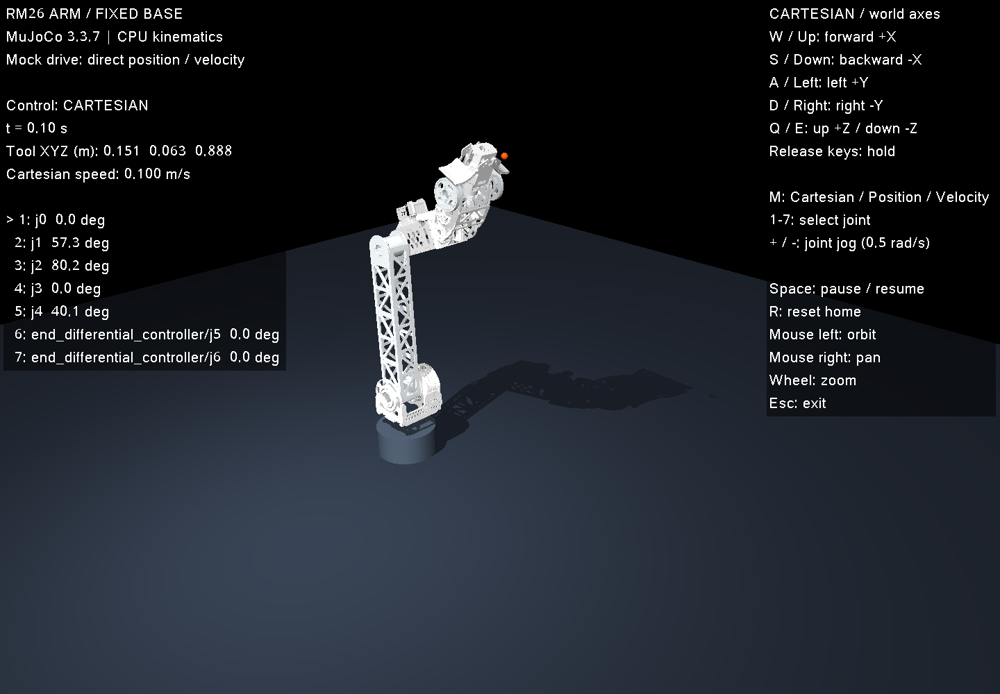

# RM26 七关节机械臂

[文档索引](README.md) · [联合逆解与规划 Demo](planning_demo.md) · [最新复现记录](reproduction_20261013.md)

`rm26_arm` 导入 HKUST RM26 version3 的真实机械臂网格和 URDF 关节链，固定底座、不包含底盘。它提供 C++ 关节位置/速度接口，以及基于 MuJoCo Jacobian 的键盘末端平移。驱动层使用运动学 mock；不计算电机力矩闭环或接触阻挡。与现有 `tech_core` 为两个独立入口。



## 构建与启动

依赖和 MuJoCo 安装沿用仓库 README。模型和网格已纳入 Git，正常构建运行不需要 Python、ROS 或联网。

```bash
./scripts/bootstrap_mujoco.sh
cmake -S . -B build -DCMAKE_BUILD_TYPE=Release
cmake --build build -j4
./scripts/run_arm_software_viewer.sh
```

软件渲染启动脚本设置 `CUDA_VISIBLE_DEVICES=""`、Mesa/llvmpipe 和 4 个渲染线程，避免占用共享 GPU。有 `DISPLAY` 时打开可交互窗口；无 `DISPLAY` 时使用 Xvfb，适合有限时长截图，**不会出现用户可见窗口**。通过本机桌面或有效的远程桌面 DISPLAY 使用键盘操作。无桌面示例：

```bash
./scripts/run_arm_software_viewer.sh --headless --duration 0.1 \
  --screenshot artifacts/rm26_arm/home.png
```

窗口关闭或 Esc 退出；脚本创建的 Xvfb 和授权临时目录由 `xvfb-run` 清理。`./build/rm26_arm` 也可直接启动，但 OpenGL 设备由桌面环境决定。

## 操作

默认控制末端 `arm_tool`，其坐标等于源 URDF 的 `ee_link`。世界坐标与源底座 `base_link` 相同：+X 前、+Y 左、+Z 上；方向不随相机改变。

| 操作 | 按键 |
|---|---|
| 前 / 后 | W / S，或 ↑ / ↓ |
| 左 / 右 | A / D，或 ← / → |
| 上 / 下 | Q / E |
| 控制模式切换 | M：末端平移 → 关节位置 → 关节速度 |
| 选择关节 | 1–7，对应界面顺序 |
| 当前关节正 / 负方向 | +（或 =）/ −，支持数字小键盘 |
| 暂停 / 恢复 | Space |
| 回到 home、重置相机和仿真时间 | R |
| 退出 | Esc |
| 旋转 / 平移 / 缩放相机 | 鼠标左键 / 右键 / 滚轮 |

持续按住才移动，松键立即保持实际位置。相反方向相互抵消，斜向输入归一化，不会增大合速度。暂停、复位、模式切换、关节选择、窗口失焦都会清除当前运动，须释放运动键后重新按下。

默认平移速度 `0.10 m/s`，用 `--speed 0.03` 调低，允许 `(0,0.10] m/s`。关节 jog 目标速率 `0.5 rad/s`；位置模式使用有限速度伺服，因此有跟踪滞后，松键时保持当前位置。界面和终端提供实际位置。

## C++ 控制接口

链接 `rm26_arm_sim`，包含 `tech_core/arm_simulation.hpp`：

```cpp
tech_core::ArmSimulation arm;
auto target = arm.joint_positions();
target[0] += 0.2;                 // rad
arm.set_joint_positions(target);
for (int i = 0; i < 1000; ++i) arm.step();

std::vector<double> velocity(arm.joint_names().size(), 0.0);
velocity[0] = 0.2;               // rad/s
arm.set_joint_velocities(velocity);
arm.step();
arm.set_cartesian_velocity({0.03, 0, 0}); // world m/s
arm.step();
arm.stop();
auto xyz = arm.tool_position();
```

每次 `step()` 推进 MJCF 的 `0.002 s`。关节顺序：`j0, j1, j2, j3, j4, end_differential_controller/j5, end_differential_controller/j6`。`joint_limits()` 提供源 URDF 位置限制，`velocity_limits()` 提供 mock 限速。home 为 `[0,1,1.4,0,0.7,0,0] rad`。

位置指令先限幅至关节范围，再采用 `qdot = clamp(8*(q_target-q), -1, 1)` 的位置伺服，防止越过目标或硬限位；速度指令限幅至 `±1 rad/s`，积分到硬限位停止。`1 rad/s` 是演示配置，源 URDF 的速度/力矩限值均为 0 占位值。NaN、无穷或维度错误会抛异常，保留原控制指令。

Cartesian 模式采用加权 6D 阻尼最小二乘，平移为输入，旋转反馈保持进入该模式时的末端朝向；姿态权重 `0.15`、阻尼 `0.005`。接近奇异位形或关节限位时速度会下降，位置/朝向跟踪为近似结果，无法保证不可达指令。没有路径规划或避碰。

mock 直接更新 `qpos/qvel` 和时间，随后 `mj_forward` 计算正运动学/Jacobian；不调用 `mj_step`。MuJoCo 的力、加速度等动力学数组不是该接口的有效硬件反馈。

## 无窗口运行和记录

```bash
# 六个平移方向的有限时长演示；CSV 50 Hz，包含初态和末态。
./build/rm26_arm --headless --demo --duration 3 --speed 0.03 \
  --csv artifacts/rm26_arm/demo.csv

# 七关节位置 / 速度指令（rad / rad/s）。
./build/rm26_arm --headless --position 0.2,1,1.4,0,0.7,0,0 --duration 2
./build/rm26_arm --headless --velocity 0.2,0,0,0,0,0,0 --duration 1

# 世界坐标末端速度；纯 CPU，不创建 OpenGL 上下文。
./build/rm26_arm --headless --cartesian 0.03,0,0 --duration 1
```

`--demo`、`--position`、`--velocity`、`--cartesian` 互斥且仅用于无窗口模式；窗口模式使用键盘。CSV 同样要求 `--headless`，字段为仿真时间、模式、实际工具 XYZ、七个实际关节角和速度。无窗口默认 2 s，`--duration` 范围 `(0,3600] s`；窗口的有限时长以累计仿真步计算，暂停不计时，R 不清除累计时长。正常退出返回 0，错误返回 1。

纯无图形构建：

```bash
cmake -S . -B build-arm-headless -DCMAKE_BUILD_TYPE=Release -DTECH_CORE_VIEWER=OFF
cmake --build build-arm-headless -j4
./build-arm-headless/rm26_arm --headless --demo --duration 3
```

## 验证和范围

上游版本、完整关节参数、URDF/MJCF 正运动学一致性和来源校验见 [模型说明](rm26_arm_model.md)；执行记录见 [验证报告](rm26_arm_validation.md)。

- 保留七个机械臂关节；附加 `end_joint` 和左右夹爪关节固定为零。差动末端的两个关节直接独立控制，未实现电机传动耦合。
- 源 `j1_link` 惯量不满足物理约束，场景使用明确的占位惯量；所有接触禁用，允许发生模型穿插，不能用于力矩、负载或抓取可行性判断。
- 本次覆盖机械臂运动控制。未接入科技核心的自由抓取、装配联动、视觉或底盘。
