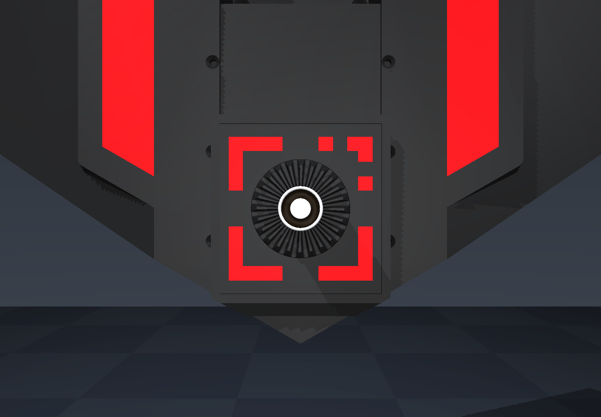
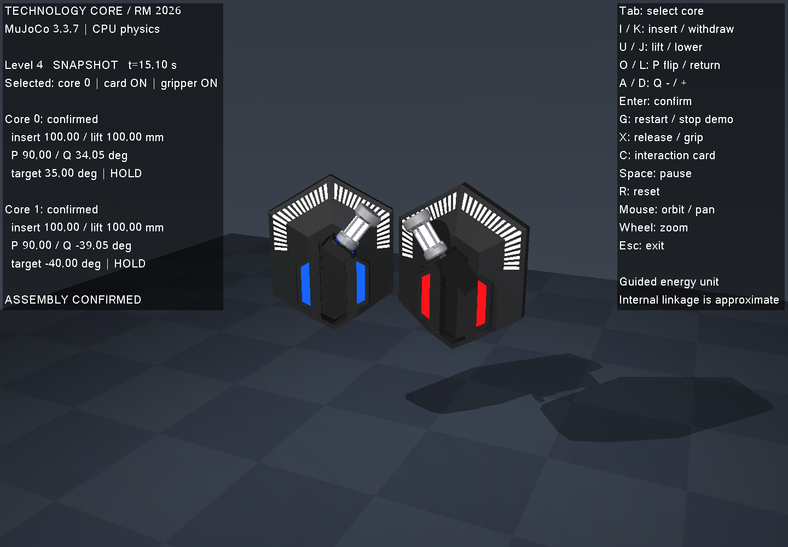

# 验证记录

日期：2026-10-11。以下结果对应 HKUST 详细网格版；初版基本几何的截图不用于本次外观验收。运行环境为 Linux x86_64、C++17、MuJoCo 3.3.7、CPU 物理和 Mesa llvmpipe 软件渲染。

## 构建与回归

```bash
cmake -S . -B build -DCMAKE_BUILD_TYPE=RelWithDebInfo -DBUILD_TESTING=ON
cmake --build build -j4
ctest --test-dir build --output-on-failure -j4
```

**11/11 通过**，最终一次总耗时 3.50 s。包括 13 组规则边界、物理接触与力矩、原始网格保真、一至四级完整装配、Q 的 ±90° 极限、倾斜核心及非法等级。另以 `TECH_CORE_VIEWER=OFF` 编译并实际完成三级 15 s 无显示运行。

物理测试独立查询不可见碰撞组：孔径 40 mm、有效深度 100 mm；居中插入 80 mm 无壁面碰撞，柱横移 6 mm 或插入 102 mm 触发接触。用于射线的碰撞组仅在测试中临时设为可见，不与真实外观混用。安全保持测试在 Q 驻留后释放夹具，继续运行 0.5 s，验证保持姿态、回零力矩 ≤0.3 N·m、保持力矩 ≤0.5 N·m；全部过程中没有 MuJoCo 警告。释放效果依赖明确声明的理想重力支撑。

## 网格、MARK 与运动

`geometry_fidelity` 使用 MuJoCo 实际编译加载后的网格，读取源 OBJ 独立比较；不是只核对生成器参数：

- 全部 60 个核心资产、两个核心的 120 个实际 geom，17,762 个顶点和 34,792 个三角面完整保留；撤销 MuJoCo 的网格居中和主轴变换后，逐顶点、三角面绕序、逐角法线和世界位置符合源 OBJ。顶点容差 0.2 µm 用于 float32 数值误差，不代表实物精度。
- 六片 MARK 在 16,928 个格点、101,568 次实际网格射线查询中符合规则的完整非对称图案，包含间隙和右上拆分角；每个核心有 36 根独立材质角度灯。
- 五个升降/P/Q 构型中，逐顶点检查柱体与灯标的刚体运动、外壳静止，以及 P 位于初始 E 的 `(-169,0,208) mm`。这些验证的是声明的近似关节链，不能证明真实内部机构。源 Blender 没有 P/Q 绑定或动画，滑块的运动归属仍是建模假设。

原 Blender 再次导出的 60 个 OBJ 和 manifest 共 61 个文件逐字节一致；MJCF 再生成也逐字节一致，见 [复现证据](evidence/asset_reproducibility.json)。独立手册/CAD 尺寸比较见 [几何审计](fidelity_geometry_audit.md)。

能量单元离线 CAD 测试 **6/6 通过**，实际读取官方 STEP，检查 291 个源面、单位/坐标/颜色、有效 BRep、法线、保持不变的外形，以及规则修订后的 φ40×100 mm 孔。七条轴向射线首次命中均为 100 mm。见 [能量单元说明](energy_cad.md)。

## 最终模型装配运行

四个等级均单独运行 15 仿真秒并返回 0 / SUCCESS。下表来自状态事件日志，单位 s；[已提交记录](evidence/assembly_runs.json) 同时保留最终实际关节 CSV 行。完整 50 Hz CSV 和日志位于忽略目录 `artifacts/fidelity/`。

| 等级/核心 | 插入 | 升降 | P 上翻 | Q 达标 | 确认 |
| --- | ---: | ---: | ---: | ---: | ---: |
| 1 | 2.330 | — | — | — | 3.202 |
| 2 | 2.330 | 4.035 | — | — | 5.001 |
| 3 | 2.330 | 4.035 | 6.170 | 8.530 | 11.502 |
| 4 核心 0 | 2.330 | 4.035 | 6.170 | 8.530 | 11.502 |
| 4 核心 1 | 2.510 | 4.215 | 6.350 | 8.735 | 11.502 |

核心到位时刻为 1.000 s。四级步骤 2、3、5、6 的完成时间差为 0.180、0.180、0.205、0 s，满足 5 s 限制。最终插入/升降均为 100 mm，P 为 90°；实际 Q 约 34.045° / −39.045°，目标为 35° / −40°，在判定窗口内。判定使用实际状态。

## 实际渲染

以下 PNG 来自最终 C++ 可执行文件的 MuJoCo 渲染，未作生成式重绘或后期修改。正面、侧面、MARK 特写、单元和双核心装配状态均已检查。MARK 特写显式使用 `--hide-unit` 隐藏单元以检查被遮挡的图案；正常模式下单元材质 alpha=1，保持不透明。






可复现截图：

```bash
./scripts/run_software_viewer.sh --headless --duration 1.1 \
  --view iso --distance 1.25 --no-overlay --screenshot artifacts/core.png
./scripts/run_software_viewer.sh --headless --duration 1.1 \
  --view marker --distance 0.28 --hide-unit --no-overlay --screenshot artifacts/marker.png
./scripts/run_software_viewer.sh --headless --demo --level 4 --duration 15.1 \
  --screenshot artifacts/level4.png
```

前两条是装配前检查，返回 2 / INCOMPLETE；第三条返回 0 / SUCCESS。另实际执行了 2 s 窗口渲染循环并正常退出。实际 renderer 为 `llvmpipe (LLVM 15.0.7, 256 bits)`。运行中和结束后完整 `nvidia-smi` 表均没有本次仿真/渲染 GPU 上下文；本次 Xvfb 和 tech_core 进程均已退出。相关日志保存在 `artifacts/fidelity/`。

清理了约 956 MB 可复现的无关场地 BREP 分件和重复导出临时目录；保留原 STEP、选中的核心 BREP、用户 PDF、原 Blender 文件和验证结果。没有持续后台任务；日志均按有限运行分别保存。

## 适用范围

验证覆盖原模型尺度与标识保真、已对准能量单元的导向装配、规则和显示。用户已接受模型与 CAD 的小幅外形差异。未实现机械臂自由抓取、视觉闭环、真实闭链机构、完整回收或整场裁判；接触代理、惯量和材质光照也不构成实物标定。具体边界见 [README](../README.md)。
