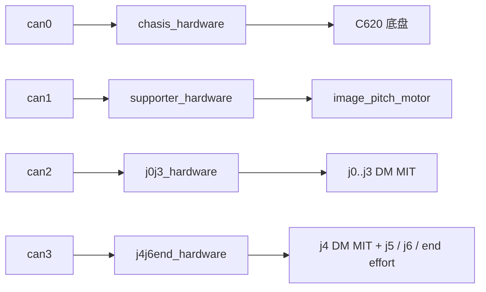
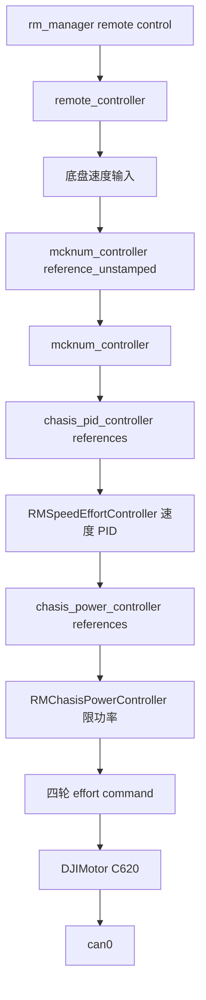
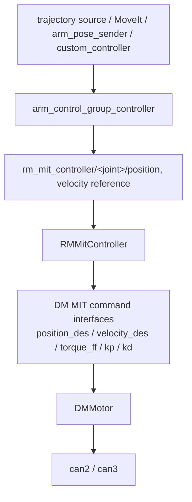
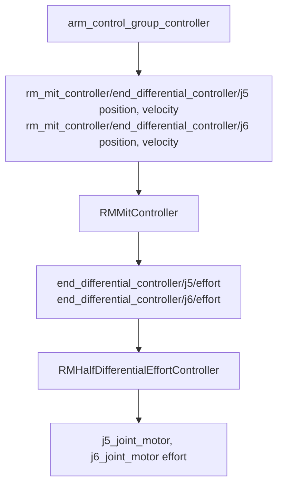
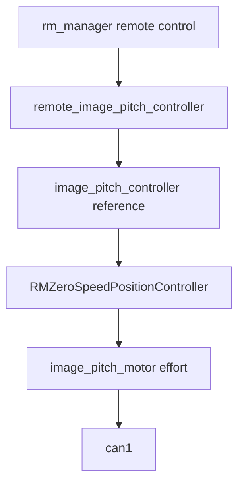

# 08 整车 control.launch.py 数据流

当前整机控制主要通过以下 launch 启动：

```text
src/RM/RMController/core/test/rm26_version3_engineering_model_moveit/launch/control.launch.py
```

本章按启动顺序和数据流解释它做了什么。

## 1. 启动的核心节点

### robot_state_publisher

`control.launch.py` 读取：

```text
config/rm26_version3_engineering_model.urdf.xacro
```

并传入：

```text
use_mock_hardware:=false
```

生成 `robot_description`。该 URDF 内包含 `rm26_version3_engineering_model.ros2_control.xacro`，定义真实 CAN 硬件。

### controller_manager / ros2_control_node

启动参数：

```python
parameters=[
  controller_config_file,
  {"cpu_affinity": 1},
  {"thread_priority": 99}
]
```

并 remap：

```text
~/robot_description -> /robot_description
```

controller 配置文件：

```text
config/ros2_controllers.yaml
```

### controller spawner

加载以下 controller：

```text
chasis_power_controller
chasis_pid_controller
mcknum_controller
end_differential_controller
rm_mit_controller
arm_control_group_controller
gripper_controller
image_pitch_controller
remote_image_pitch_controller
joint_state_broadcaster
```

## 2. 硬件接口数据流

`rm26_version3_engineering_model.ros2_control.xacro` 定义 4 个 CAN 硬件组：



每组硬件都使用：

```xml
<plugin>RM_hardware_interface/RM_CanDeviceHardwareInterface</plugin>
```

硬件 `read()` 从 CAN 口读反馈，更新 state interfaces；硬件 `write()` 把 controller 输出打包为 CAN 帧发出。

## 3. 底盘数据流



v3 的 `ros2_controllers.yaml` 中 `mcknum_controller.use_stamped_vel=false`，因此底盘控制器实际入口是 `/mcknum_controller/reference_unstamped`。当前 `remote_controller` 包的默认输出仍是 `/mcknum_controller/reference` 的 `TwistStamped`，`ref.yaml` 也没有覆盖 `cmd_vel_topic`；如果要让遥控直接驱动 v3 底盘，启动前应把两端对齐，例如改 `mcknum_controller.use_stamped_vel=true`，或增加一个 `TwistStamped -> Twist` 转接节点/修改 `remote_controller` 输出类型。源码中的调试脚本走的是 `reference_unstamped`。

`remote_controller` 同时发布：

- `/enable_chasis`
- `/enable_arm`
- `/remote_controller/button/<NAME>`
- `/remote_controller/wheel_less_400`
- `/remote_controller/wheel_bigger_1600`

这些 topic 被硬件接口、归零逻辑、UI 和应用节点使用。

## 4. 机械臂数据流

机械臂主控制链：



`arm_control_group_controller` 是 `rm_joint_trajectory_controller/JointTrajectoryController` 的实例，不是一个独立包。它控制的 joints 包括：

```text
j0, j1, j2, j3, j4,
end_differential_controller/j5,
end_differential_controller/j6
```

`command_prefix` 全部指向 `rm_mit_controller`，说明轨迹控制器输出给 MIT 控制器的链式 reference interface。

## 5. 末端差动与夹爪

末端 `j5/j6` 由两个真实电机 `j5_joint_motor`、`j6_joint_motor` 通过 `end_differential_controller` 解耦为虚拟 roll/pitch joint。轨迹控制器并不是直接驱动差动控制器，而是先输出到 `rm_mit_controller` 的链式 reference：



夹爪由 `gripper_controller` 控制真实 `end_joint`，并映射到左右连杆 joint。

## 6. 图传 pitch

图传 pitch 链路：



`image_pitch_controller` 配置了 `zero_topic: /remote_controller/wheel_bigger_1600`，可通过遥控滚轮触发归零。

## 7. rm_manager 与应用节点

`control.launch.py` 同时启动：

- `rm_manager`：裁判系统/图传串口。
- `remote_controller`：遥控输入映射到底盘速度和按钮 topic。
- `rm_custom_controller`、`rm_custom_controller_state`、`rm_button_action`：自定义控制器与按钮触发。
- `rm26_energy_unit_pap`、`rm_arm_pose_sender`、`arm_trajectory_record_replay`、`trajectory_sender`：能量机关/机械臂动作相关应用。
- `rm_ui`、`rm26_ui_hub`：图传 UI 绘制。

以上是主要应用节点；实际 launch 还包含多个 `rm_button_action` 触发器和 3 个 `rm26_energy_unit_pap` 实例。`auto_up_bench` 相关函数和配置保留在源码中，但当前 `control.launch.py` 未把它加入 `LaunchDescription`。

因此整机 launch 不是单纯的 ros2_control 启动文件，而是把底盘、机械臂、图传 UI、裁判系统和自动任务全部拉起来的集成入口。

迁移工作区时要特别检查自动任务和轨迹回放配置。当前 v3 `control.launch.py` 中的能量机关轨迹会从 package share 下的 `config/trajectory/energy_unit_auto_pap/` 解析，`trajectory_sender` 也应优先使用相对 package 配置目录的轨迹文件。新增轨迹配置时不要写本机专属路径，否则换工作区后会出现 `Trajectory file does not exist`。

## 8. 启动检查命令

```bash
ros2 control list_controllers
ros2 control list_hardware_components
ros2 topic echo /mcknum_controller/reference_unstamped --once
ros2 topic echo /remote_controller/button/STOP --once
ros2 topic echo /rm_manager/remote_control --once
ros2 topic echo /joint_states --once
```

没有真实裁判系统时，`/rm_manager/remote_control` 可能没有数据；没有 CAN 设备时，硬件组件可能无法激活。这类现象适合用来判断软件启动链路是否走通，但不能等同于实机闭环控制已经完成。
