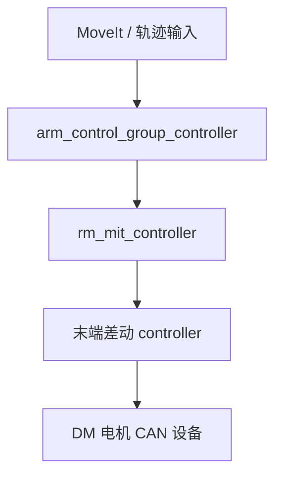
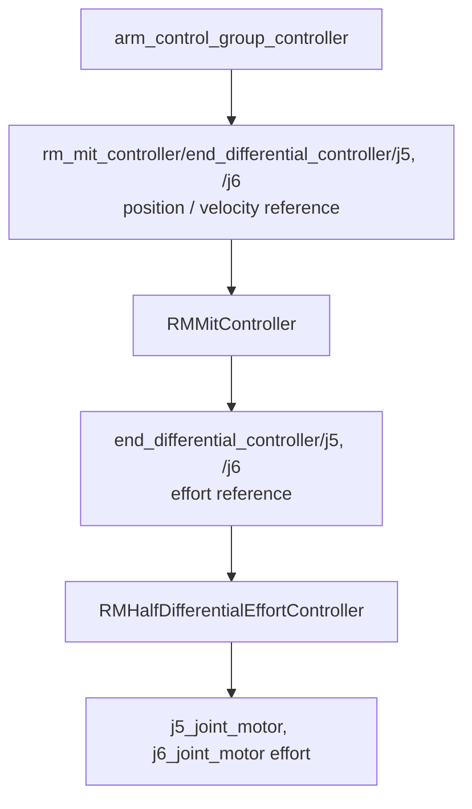
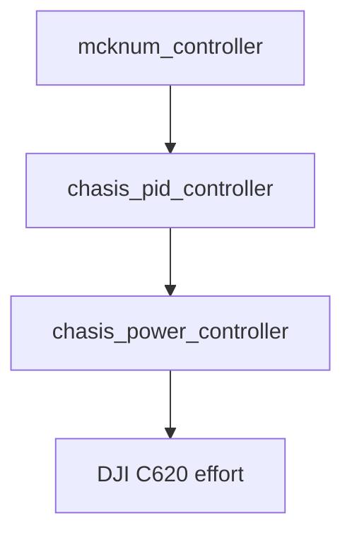

# 09 机械臂控制与底盘功率控制特点

本章分为两个部分：第一部分说明机械臂控制，第二部分说明底盘功率控制。二者都基于 ros2_control 的 controller 链式接口，但解决的问题不同：机械臂侧关注轨迹、动力学补偿与末端差动；底盘侧关注速度闭环后的功率估算与限幅。

## 第一部分：机械臂控制

### 1.1 机械臂控制不是单个 controller

整机 v3 中 `arm_control_group_controller` 是一个 controller 实例，类型为：

```text
rm_joint_trajectory_controller/JointTrajectoryController
```

它负责接收轨迹并输出每个关节的 position/velocity reference。真正的力矩、阻抗和重力补偿在 `rm_mit_controller` 中完成。

机械臂主链路可以理解为：



其中 `arm_control_group_controller` 更接近轨迹插值和 reference 分发层，`rm_mit_controller` 才是机械臂控制律的核心。

### 1.2 RMMitController 特点

插件名：

```text
RM_hardware_interface/RMMitController
```

基类：`controller_interface::ChainableControllerInterface`。

主要特点：

- 订阅 `robot_description`，使用 Pinocchio 构建机器人模型。
- 通过 `control_joint_line` 裁剪目标子臂模型。
- `control_joints` 可指定实际受控关节；为空时使用子臂全部关节。
- 支持公开控制模式 `GRAVITY` 和 `IMPEDANCE`。
- 支持内部 `SAFE_RESTORE`，用于电机失能后 ref/state 差距过大时的安全恢复。
- 支持动态负载配置、摩擦补偿、DOB 扰动观测器、TF 重力方向修正。

整机 v3 配置中：

```yaml
control_joint_line: ["j0", "end_differential_controller/j6"]
control_joints:
  - j0
  - j1
  - j2
  - j3
  - j4
  - end_differential_controller/j5
  - end_differential_controller/j6
```

### 1.3 RMMitController 的接口

对 MIT 电机，它写入：

```text
<joint>/position_des
<joint>/velocity_des
<joint>/torque_ff
<joint>/kp
<joint>/kd
```

对非 MIT 电机，它可写 `<joint>/effort`。

它导出的链式 reference interface 通常是：

```text
rm_mit_controller/<joint>/position
rm_mit_controller/<joint>/velocity
```

因此 `arm_control_group_controller` 的 `command_prefix` 设为 `rm_mit_controller` 后，轨迹输出会流入 MIT 控制器。

### 1.4 SAFE_RESTORE

`safe_restore_mode` 用于处理“电机曾经失能，重新使能时目标位置与当前状态差距过大”的情况。进入后控制律仍类似阻抗控制，但使用更保守的 `safe_restore_kp/kd`，并不使用 DOB。

典型参数：

```yaml
safe_restore_mode:
  enable: true
  kd_ratio: 0.9
  kp: [11.0, 15.0, 6.0, 2.0, 3.0, 2.0, 1.0]
  trigger_threshold: [0.5, 0.5, ...]
  restore_threshold: [0.2, 0.2, ...]
```

这对于工程机器人机械臂很重要：机械臂惯量大，直接从远离目标的位置恢复高刚度控制容易产生冲击。

### 1.5 末端差动

`RMHalfDifferentialEffortController` 把两个真实电机映射为末端 roll/pitch 虚拟关节。整机配置中：

```yaml
roll_motor: j6_joint_motor
pitch_motor: j5_joint_motor
roll_joint: j6
pitch_joint: j5
```

上游轨迹控制器看到的是 `end_differential_controller/j5` 和 `end_differential_controller/j6`，下游硬件实际控制的是 `j5_joint_motor` 和 `j6_joint_motor`。

完整链路是：



### 1.6 当前动态精度与局限

当前机械臂控制框架已经具备轨迹跟踪、重力补偿、阻抗控制和安全恢复链路，但动态精度仍然不佳，尤其是在快速轨迹、负载变化、末端姿态变化较大的工况下，实机跟踪误差会明显放大。

可能原因包括：

- 机器人动力学模型还不够准确，URDF 中的质量、质心、惯量、传动比、末端负载与实机存在偏差。
- 摩擦、背隙、同步带/差动结构柔性、线缆拖拽等非理想因素没有被充分建模。
- 当前控制算法仍需要精进，阻抗参数、重力补偿、DOB 扰动观测器和轨迹前馈之间还需要系统辨识与实机调参。
- 轨迹生成侧的速度、加速度、加加速度约束会直接影响动态跟踪效果，过激的参考输入会放大模型和控制参数误差。

因此，现阶段更适合把机械臂控制框架理解为可扩展的工程基础：接口链路、controller 分层和安全恢复机制已经搭好，但若要追求更高动态精度，需要继续做模型辨识、控制律优化和实机调参。

## 第二部分：底盘功率控制

### 2.1 底盘功率控制链路

底盘配置中三层 controller 串联：



v3 配置中 `mcknum_controller.use_stamped_vel=false`，底盘入口使用 `/mcknum_controller/reference_unstamped` 的 `geometry_msgs/msg/Twist`。`remote_controller` 当前默认发布 `TwistStamped`，实际遥控闭环前需要把输入类型与 topic 对齐。

`mcknum_controller` 将底盘速度命令转成四轮速度目标。`RMSpeedEffortController` 做速度 PID，输出每个轮子的 effort reference。`RMChasisPowerController` 在最终写入真实电机前做功率限制。

### 2.2 RMChasisPowerController 特点

插件名：

```text
RM_hardware_interface/RMChasisPowerController
```

基类：`controller_interface::ChainableControllerInterface`。

功率模型近似为：

```text
P = k1 * omega^2 + k2 * tau^2 + alpha + omega * tau
```

其中：

- `omega`：轮电机状态速度。
- `tau`：期望或状态力矩。
- `k1/k2/alpha`：通过拟合得到的损耗模型参数。

控制器读取上游 PID 的 effort reference，估算总功率。如果总功率超过 `power_limit`，就按比例缩放可用功率，并反解每个轮子的 effort 命令。

整机 v3 配置示例：

```yaml
motor_names: [fl_joint, fr_joint, rl_joint, rr_joint]
k1: [0.0188, 0.0178, 0.018, 0.018]
k2: [2.95, 2.9, 3.13, 3.26]
alpha: [0.95, 0.95, 0.95, 0.95]
power_limit_max: 120.0
```

运行时可通过 `power_limit_topic_name`，默认 `power_limit`，动态修改限制。

### 2.3 ParamFitController

同一个包中还有：

```text
RM_hardware_interface/ParamFitController
```

用于在线拟合底盘功率模型参数。它可使用正弦力矩激励或外部 topic 输入，读取速度、力矩和电源功率，使用 RLS 拟合 `k1/k2/alpha`。

参考：

```text
core/rm_chasis_power_controller/QUICKSTART.md
core/rm_chasis_power_controller/launch/fit_chasis/config/ros2_controller.yaml
```

### 2.4 开源致谢

底盘功率控制的建模、限幅和参数拟合思路离不开 RoboMaster 社区已有开源资料的启发。特别感谢以下队伍的公开分享：

- 香港科技大学 ENTERPRIZE 战队：[【RM2024-功率控制算法开源（含舵轮，轮腿，全自动调参）】香港科技大学ENTERPRIZE战队](https://bbs.robomaster.com/article/54121?source=4)。
- 西交利物浦大学：[【RM2023-电机功率模型与功率控制开源】西交利物浦大学](https://bbs.robomaster.com/article/9438?source=4)。

本工程的功率控制实现仍以当前源码中的 controller 链路和实车参数为准；阅读上述开源时，建议重点对照功率模型形式、限幅策略、参数辨识流程和超级电容/裁判系统约束的处理方式。

### 2.5 使用风险

- `chasis` 是源码拼写，controller 名称和 topic 都要保持一致。
- 功率限制效果依赖 `k1/k2/alpha` 准确性，换底盘、换轮、电机参数变化后应重新拟合。
- 限功率只能限制上位机发出的命令，不能替代裁判系统/电控层硬保护。
- 功率限制位于速度 PID 之后，过高的速度环输出会先被 power controller 缩放，表现为底盘动态响应变软或加速度下降。
