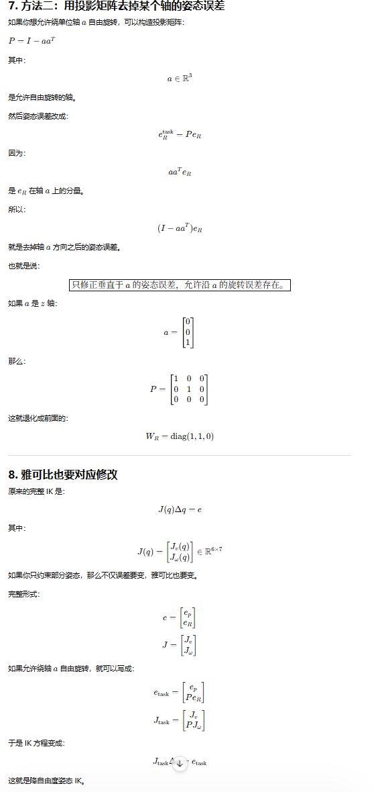

# IK逆解

<aside>
💡

- 主要以数值解为主
- 以7自由度为主
- 以下所有内容都需要在同一个对齐坐标系中进行
</aside>

# 基本定义

## **机械臂正运动学**

$$
T=f(q)
$$

其中：

$$
q =\begin{bmatrix}q_1 & q_2 & \cdots & q_7\end{bmatrix}^T\in \mathbb{R}^7
$$

为 7 个关节角，末端位姿为：

$$
T\in SE(3)
$$

也就是：

$$
T = \begin{bmatrix}R & p \\ 0 & 1\end{bmatrix}
$$

其中：

$$
R \in SO(3), \quad p \in \mathbb{R}^3
$$

分别表示旋转矩阵以及平移矩阵

<aside>
💡

$SO(3)$ 和 $SE(3)$ 为群

</aside>

## **机械臂逆运动学**

给定末端位姿

$$
T_d =\begin{bmatrix}R_d & p_d \\ 0 & 1\end{bmatrix}
$$

求得关节角：

$$
q^*
$$

使得：

$$
f(q^*) = T_d
$$

<aside>
💡

对于一般6轴机械臂来说，6个位姿约束对应六个自由度，刚刚好。但是7个自由度的机械臂会有一个冗余自由度。

</aside>

**七自由度机械臂IK**

理论上来说，对于同一个末端位姿7自由度的机械臂通常由一组解

$$
q = q(\alpha)
$$

## 位姿误差表示

数值 IK 和优化 IK 的核心是构造误差函数

$$
e(q)
$$

优化目标为

$$
e(q) = 0
$$

末端位姿误差通常分为位置误差和姿态误差。也就是 $xyz$ 和 roll, pitch, yaw。

### 位置误差

$$
e_p = p_d - p(q)
$$

其中：

- $e_p \in R^3$
- $q$ 为机械臂关节角度
- $p()$ 为机械臂关节空间到末端位置的映射

### 姿态误差

姿态误差不能直接写成

$$
R_d - R(q)
$$

因为旋转矩阵不属于普通欧氏空间。更常见的做法是用李群 $SO(3)$ 上的对数映射：

$$
e_R  = \log(R(q)^TR_d)
$$

其中：

- $e_R \in \R^3$
- 取 $\log$ 简单理解为 $\log(\text{旋转矩阵}) = \text{旋转向量}$
- $R(q)^TR_d = R(q)^{-1} R_d$ 因为 $R(q)$ 为旋转矩阵，是正交矩阵，逆等于转置

简单理解来说，就是看看在**末端自己的坐标系下**，末端位姿和目标还差多少。

同时也有另外一种写法

$$
e_R  = \log(R_dR(q)^T)
$$

表示误差在**世界坐标系 / 基坐标系**下表达。

**这里的误差需要和使用的雅可比对应**

### 整体 6 维位姿误差

$$
e(q) =\begin{bmatrix}e_p \\ e_R\end{bmatrix}\in \mathbb{R}^6
$$

目标为

$$
e(q) \to 0
$$

实际工程中可以进行加权

$$
e(q) =\begin{bmatrix}w_p e_p \\ w_R e_R\end{bmatrix}
$$

### 末端降自由度误差

问题定义为将让末端执行器可以在某个自由度上有一定冗余，这需要对于误差向量进行一些修改

#### 位置误差

#### 位姿误差

关于位姿误差，此处只讨论关于约束工具方向轴的问题，也就是末端工具指定指向某个轴

设工具坐标系下的局部轴（目标指向）为：

$$
a_0 =\begin{bmatrix}0 \\0 \\1\end{bmatrix}
$$

当前工具轴方向是：

$$
a(q) = R(q)a_0
$$

其中：

- $R(q)$ 为当前位姿下的旋转矩阵，这一步将 $a_0$ 映射到世界坐标系下。
- $q$ 为当前机械臂关节角

目标工具轴方向是：

$$
a_d = R_d a_0
$$

只要求：

$$
a(q) = a_d
$$

可以构造误差：

$$
e_{\text{axis}} = a(q) \times a_d
$$

或者

$$
e_{\text{axis}} = a_d \times a(q)
$$

<aside>
💡

它的物理意义是：

当前工具轴要转到目标工具轴，所需的旋转轴方向和误差大小。

因为这里的 $a_d$ 和 $a(q)$ 均为轴，他们的叉乘的模长表示旋转所需的角度，即：

$$
|a(q)\times a_d| = \sin\theta
$$

注意叉乘顺序。以及他们均为单位向量

</aside>

当：

$$
a(q) \parallel a_d
$$

时：

$$
e_{\text{axis}} = 0
$$

此时工具轴已经对齐，但绕工具轴自己的旋转角仍然可以是任意的。

<aside>
💡

如果出现 180 度时，叉乘会退化

如果：

$$
a(q) = -a_d
$$

也就是两个方向完全相反，夹角是 ($180^\circ$)。

$$
a(q)\times a_d = 0
$$

但它们显然没有对齐。

所以工程实现中通常还要检查点积：

$$
a(q)\cdot a_d
$$

如果：

$$
a(q)\cdot a_d \approx -1
$$

说明接近反向，需要特殊处理，比如选择一个和 (a(q)) 垂直的任意轴作为修正方向。

</aside>

<aside>
💡

有一个使用权重矩阵消除误差的方式，但是感觉有点复杂了，不推荐，贴个图在这里

</aside>

## 雅可比矩阵：数值 IK 的核心

机械臂末端速度和关节速度之间满足：

$$
\dot{x} = J(q)\dot{q}
$$

其中：

$$
\dot{x} =\begin{bmatrix}v \\ \omega\end{bmatrix}\in \mathbb{R}^6
$$

$$
\dot{q} \in \mathbb{R}^7
$$

$$
J(q) \in \mathbb{R}^{6 \times 7}
$$

对于 7 自由度机械臂，雅可比是一个 ($6 \times 7$) 的矩阵。

因为列数比行数多，所以方程：

$$
J(q)\Delta q = e
$$

通常有无穷多个解。

这就是数值 IK 中冗余自由度的数学来源。

<aside>
💡

这个方程的意思是，在当前位姿为 $q$ 的情况下，我们希望找到一个偏移角度 $\Delta q$ 使其移动可以补足这里的误差。

</aside>

# 数值逆解方法

## Jacobian Pseudo-Inverse

最经典的数值 IK 方法是伪逆法：

$$
\Delta q = J^+ e
$$

其中：

$$
J^+ = J^T(JJ^T)^{-1}
$$

当 ($J$) 满秩时，伪逆可以找到最小范数的关节增量：

$$
\Delta q^\star = \arg\min_{\Delta q} |\Delta q|^2
$$

subject to:

$$
J\Delta q = e
$$

迭代过程为：

$$
q_{k+1} = q_k + \Delta q
$$

也就是：

$$
q_{k+1} = q_k + \alpha J(q_k)^+ e(q_k)
$$

- $\alpha$ 为步长

<aside>
💡

这里可以限制关节旋转角度作为限制

$$
q_{k+1}=q_k+\operatorname{clip}(\alpha\Delta q,-\Delta q_{\max},\Delta q_{\max})
$$

或者阻尼最小二乘

$$
\Delta q =J^T(JJ^T+\lambda^2 I)^{-1}e
$$

更新写成：

$$
\boxed{q_{k+1}=
q_k+\alpha J^T(JJ^T+\lambda^2 I)^{-1}e}
$$

</aside>

缺点是靠近奇异点时：

$$
JJ^T
$$

可能接近不可逆，导致关节速度暴涨。

## Damped Least Squares, DLS

为了处理奇异性，工程中更常用阻尼最小二乘法：

$$
\Delta q = J^T(JJ^T + \lambda^2 I)^{-1}e
$$

其中 ($\lambda$) 是阻尼因子。

它等价于求解：

$$
\Delta q^\star =\arg\min_{\Delta q}\left(|J\Delta q - e|^2+\lambda^2 |\Delta q|^2\right)
$$

这个方法的含义是

既希望末端误差变小 $|J\Delta q - e|^2$

又不希望关节变化过大： $|\Delta q|^2$

当机器人远离奇异点时，可以使用较小阻尼：

$$
\lambda \approx 10^{-4} \sim 10^{-2}
$$

当机器人接近奇异点时，可以增大阻尼。

一种常见策略是根据雅可比最小奇异值调整阻尼：

$$
\lambda =\begin{cases}0, & \sigma_{\min} \ge \sigma_0 \\ \lambda_0 \left(1 - \frac{\sigma_{\min}}{\sigma_0}\right)^2, & \sigma_{\min} < \sigma_0\end{cases}
$$

其中 ($\sigma_{\min}$) 是 ($J$) 的最小奇异值。

## 带零空间项的冗余控制

标准形式是：

$$
\Delta q = J^+ e + (I - J^+J)z
$$

其中：

$$
N = I - J^+J
$$

叫做零空间投影矩阵。

它有一个重要性质：

$$
JN = 0
$$

因此：

$$
J \left( J^+ e + Nz \right) = JJ^+e + JNz = JJ^+e

$$

也就是说，第二项 (Nz) 不会影响末端一阶运动。

这里的 (z) 可以用来优化次级目标。

### 常见零空间优化目标

#### 远离关节限位

代价函数可以写成：

$$
H_{\text{limit}}(q)=
\sum_{i=1}^{7}\left(\frac{q_i - q_{i,\text{mid}}}{q_{i,\max} - q_{i,\min}}\right)^2
$$

越靠近关节边界，代价越高。

#### **保持接近当前姿态**

$$
H_{\text{smooth}}(q) = |q - q_{\text{prev}}|^2

$$

这个目标可以减少 IK 解跳变。

#### **避障**

对于机械臂上的某个控制点 ($p_i(q)$)，障碍物距离为：

$$
d_i(q)
$$

$$
H_{\text{obs}}(q) =  \sum_i\phi(d_i(q))
$$

其中：

$$
\phi(d) =\begin{cases}\frac{1}{2}\left(\frac{1}{d} - \frac{1}{d_0}\right)^2, & d < d_0 \\ 0, & d \ge d_0\end{cases}
$$

当距离小于安全阈值 ($d_0$) 时产生避障代价。

#### **最大化可操作度**

Yoshikawa manipulability 常写为：

$$
w(q) = \sqrt{\det(JJ^T)}
$$

希望机械臂远离奇异点，可以最大化：

$$
w(q)
$$

或者最小化：

$$
H_{\text{sing}}(q) = -w(q)
$$

#### **保持肘部方向**

对于 7 自由度机械臂，经常希望肘部在某个方向，例如“肘部向上”或者“肘部向外”。

可以定义肘部点：

$$
p_e(q)
$$

然后让它接近目标肘部位置：

$$
H_{\text{elbow}}(q)=
|p_e(q) - p_{e,d}|^2
$$

## 非线性规划

No things

# 指定末端工具朝向进行轨迹点逆解

## 问题描述

给定一个轨迹点，每一个轨迹点有每一个轨迹点有两部分约束

- 末端位置约束
- 末端工具指向约束

给定一个机械臂，求机械臂的每个点的对应位姿，不用考虑如何进行速度/加速度规划。

形式话地来说：

在相对于基座标系下：

对于一个轨迹

$$
\mathcal{P}=
\{(p_{d,1},\alpha_{d,1}), (p_{d,2},\alpha_{d,2}), \dots, (p_{d,N},\alpha_{d,n})\}
$$

每个轨迹点包含如下约束

- $p_n$ 表示末端工具系的位置约束
- $a_n$ 表示末端工具指向约束

需要为每一个轨迹点给出一个位姿，将所有位姿连起来得到一个机械臂轨迹

## 关键定义

- $q$ 为机械臂各个关节角度

## 算法设计

### 计算约束逆解

#### 逆解约束

对于轨迹点 $(p_{d,i},a_{d,i})$，已知上一个轨迹点解出的结果为 $q_{i-1}$

工具局部轴（在工具坐标系下）定义为

$$
a_0 = \left[\begin{matrix}0 \\ 0 \\ 1\end{matrix}\right]
$$

假设当前关节角为：

$$
q_i
$$

末端位姿通过正运动学得到为：

$$
T(q_i) = \left[\begin{matrix}R(q_i)& p(q_i)\\ 0 & 1\end{matrix}\right]
$$

所以当前工具系在基座标下的方向为：

$$
a(q_i) = R(q_i)a_0
$$

目标是让:

$$
p(q_i) \approx p_{d,i}
$$

并且：

$$
a(q_i) = a_{d,k}
$$

#### 逆解误差定义

对于轨迹点 $i$ ，定义位置误差为：

$$
e_p = p_{d,k} - p(q_i)
$$

定义工具轴方向误差为：

$$
e_a = a(q_i)\times a_{d,k}
$$

<aside>
💡

这里假设了迭代过程中坐标轴指向在当前状态和目标状态差距不大，所以可以用叉乘近似

</aside>

整体任务误差写成

$$
e = \left[\begin{matrix}w_pe_p \\ w_a e_a\end{matrix}\right]
$$

其中：

- $w_p$： 位置误差权重
- $w_a$：轴方向误差权重

#### 任务雅可比

对于第 $i$  个轨迹点，相对于机械臂base_link，写末端工具系的机械臂的雅可比：

$$
J(q) = \left[\begin{matrix}j_v(q_i) \\ j_w(q_i)\end{matrix}\right]
$$

其中：

- $j_v(q_i)$ 表示关节速度到线速度的映射
- $j_w(q_i)$ 表示关节速度到角速度的映射

因为我们允许当前工具轴 $a(q_i)$，所以需要删除掉角速度中沿着 $a(q)$ 的分量

$$
\boxed{P_a = I - a(q)a(q)^T}
$$

要求 $a(q)$ 是单位向量。

然后任务雅可比写成：

$$
J_{\text{task}}=
\begin{bmatrix}w_p J_v\\w_a P_a J_\omega\end{bmatrix}
$$

这表示：

- 位置部分完整约束；
- 姿态部分只约束会改变工具轴方向的角速度；
- 绕工具轴自身的角速度被投影掉，不参与误差修正。

#### DLS 主任务求解

对于当前轨迹点，要求：

$$
J_{\text{task}}\Delta q \approx e
$$

使用 Damped Least Squares：

$$
\Delta q_{\text{task}}=
J_{\text{task}}^T\left(J_{\text{task}}J_{\text{task}}^T+\lambda^2 I\right)^{-1}e
$$

其中：

$$
\lambda
$$

是阻尼因子。

这个形式可以理解为求解：

$$
\Delta q_{\text{task}}=
\arg\min_{\Delta q}\left(|J_{\text{task}}\Delta q-e|^2+\lambda^2|\Delta q|^2\right)
$$

也就是说：

既希望末端误差变小，又不希望关节增量过大。

对于第 $i$ 个轨迹点，做如下迭代

$$
q_{i,j} = \alpha\Delta q_{\text{task}}+ q_{i,j-1}
$$

其中

- $\alpha$ 为步长
- $q_{i,0} = q_{i-1}$

同时增加关节单步最大增量限制

$$
|\Delta q_i| \le \Delta q_{\max}
$$

也就是

$$
\Delta q\leftarrow\operatorname{clip}(\alpha \Delta q,-\Delta q_{\max},\Delta q_{\max})
$$

$$
q \leftarrow q+\Delta q
$$

#### 零空间项：保持接近参考姿态

可以先不用？暂时空置

#### 零空间投影

可以先不用？暂时空置